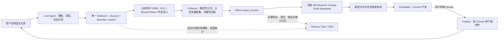

<!--
Template source: office_engine/docs/skill/odoo-project-workflow/references/templates/Designing/TDD模板.md
Template version/status: v1.0.0 Frozen; template-sync check: PASS (2026-11-18)
Frozen by project owner on 2026-11-18 with implementation details assigned to the proposed CCs; freezing does not authorize implementation.
-->

# Office Engine M4 技术设计说明书 v0.2

| 项目 | 内容 |
|---|---|
| 文档编号 | TDD-OFFICE-ENGINE-M4 |
| 版本 | v0.2 |
| 状态 | **FROZEN WITH OPEN ITEMS — 2026-11-18；细节由对应 CC 实施与验证；不授权实施** |
| 项目 | `odoo18e_llm` / `office_engine` |
| 编写日期 | 2026-11-18 |
| 技术负责人 | 待项目负责人确认 |
| 设计对象 | Office Agent Standard 的 M4 自主 Agent 能力；范围按项目负责人最新明确决策 |
| 业务需求基线 | Office Agent Standard 与项目负责人明确的 M4 范围；冻结 SRS 原文仅作为历史基线参考，见 §0.3 |
| 技术基线 | M2 TDD v2.1.0 + 已批准修订；M3 TDD v0.4 Frozen with Open Items + 2026-11-16 Implementation Compatibility Addendum |
| 证据基线 | M4 TV Closure Record、Targeted TV Plan v0.2 / Execution Report / Retest、RCA-001～008、M4_SRS_Scope_Alignment_Report、SPK-M4-DISCOVERY-01、SPK-M4-MESSAGE-01、SPK-M4-AGGREGATION-01 |

> 项目负责人于 2026-11-18 批准本 TDD v0.2 冻结。M4 TV 关闭表示证据收集阶段结束，不代表 TV 全部通过；未解决的技术细节保留原状态并映射到对应 CC 的实施与验证，不阻断本次 TDD 冻结。冻结不授权编码、Provider 调用、数据库操作、CC 创建或发布。

## 0 文档说明

### 0.1 定位

本文在现有 M2/M3 Office Engine 上，为 Office Agent Standard 中的 M4 自主行为提出技术边界、候选架构和验证契约。STD-01～03 及用户自然语言业务结果验收原则以 [Office Engine 项目认知](../context/cognition/OFFICE_ENGINE_PROJECT_COGNITION.md) 为能力标准输入；M4 范围遵循项目负责人本轮明确决策。冻结 SRS 原文不在本轮改写。工具调用、XLSX 生成或单个成功 HVR 都不单独证明 Agent 已达到整体标准。

M4 的设计目标是：Agent 对自然语言任务完成业务意图理解、模型/字段/关系发现、动态计划、工具协同、结果核验及安全失败恢复；由既有 Odoo / M3 / M2 确定性服务执行权限、数据完整性交付、文件/版本安全和用户确认。不得用本地业务规划器、Excel Writer 或报表计算引擎替代 Agent 与 Hosted Code Interpreter。

### 0.2 权威基线与证据状态

| 输入 | 状态 | 本稿用法 |
|---|---|---|
| Office Agent Standard STD-01～03 | 项目认知输入；不是 SRS/TDD 冻结文档 | 定义 M4 自主能力评价维度和最终业务任务完成标准。 |
| SRS `SRS_office_document_automation_v1.1.0.md` | Frozen historical baseline | 原文保持不变；本 TDD 的 M4 实施范围按项目负责人最新明确决策。 |
| M2 TDD v2.1.0、已批准工具边界修订及 fileless-create as-built amendment | Frozen / approved | 保留既有 `office` / Retriever 边界、Hosted CI 文件流、M2 空白工作簿合法路径和确认行为。 |
| M3 TDD v0.4 + Addendum | Frozen with open items / owner-authorized compatibility addendum | 保留 `odoo_record_retriever`、`office.export_records`、当前用户 ORM、Collector/handoff 完整性、Route B、Candidate 生命周期、Silent Retrieval 与实现兼容范围。 |
| M3 Implementation Plan v0.3、CC-M3-01/02/03 v0.2 及 ATR/HVR/FR | 历史冻结计划和实施证据 | 复用已验证组件能力，不能替代 M4 Agent 自主能力验证。 |
| M4 Targeted TV v0.2、执行报告 v0.1、Retest 2026-11-18 | 本轮 TV 基线 | 每个设计结论仅在相应 TV 实际覆盖范围内成立；失败不被改写。 |
| RCA-001～008 | RCA 汇总及个别记录 | 作为根因状态与假设来源；RCA-004/006/007/008 未验证边界原样保留。 |

### 0.3 M4 范围决策

项目负责人已明确：M4 解决 Office Agent Standard 暴露的核心能力问题——意图理解与业务条件完整性、自然语言到正确模型/字段的发现、跨工具执行并完成业务目标、参数错误后的有界自我纠正，以及结果验证与失败消息交付。工具调用成功本身不代表任务完成。

本轮 M4 不开发企业级白名单配置审批、策略版本管理或额外字段审批流程；不开发独立审计管理平台、审计审批工作流或其他额外治理机制；不预设后续 M5 治理阶段。冻结 SRS 原文件保持不变，但其中相关历史描述不构成本 TDD 的新增开发项、待决事项或冻结阻断条件。

继续保留现有技术安全机制：Odoo ACL、Record Rules、当前已存在且必要的字段访问控制、文件完整性校验、Candidate/Accept/Finalize 用户确认门禁，以及现有执行日志和诊断能力。M4 不新增安全审批层或超出现有机制的限制。决策记录见 [M4 SRS 范围决策更新](../verification/M4_TV/M4_SRS_Scope_Alignment_Report.md)。

### 0.4 设计原则及不回答事项

| 强制边界 | 技术含义 |
|---|---|
| LLM 负责业务理解和动态规划 | Agent 自主选模型、字段、关系、过滤条件、排序及输出规划；可根据发现和结果调整下一步。初始无需知道完整流程，不暴露或要求隐藏思维链。 |
| 确定性执行器不做业务规划 | Retriever / Collector 执行 Agent 给定的通用计划，做 ORM 权限检查、分页、关联收集及客观完整性校验；不得硬编码模型或业务词规则来代替计划。 |
| Office 内容沿用 M2 Route B | LLM + Hosted Code Interpreter 创建/编辑 XLSX、公式和聚合；本地代码不生成或修补业务工作簿内容。 |
| 正确业务结果优先 | E2E 必须核对业务约束、记录身份/值/关系、公式或聚合、文件可读性及最终交付状态；Tool Call 成功或文件存在不构成通过。 |
| 确认与版本门禁不变 | Candidate、Current、Accept、Reject、Finalize、版本 lineage 与 SHA 校验沿用 M2/M3；Accept 前不得推进 Current。 |
| 安全和通用性 | 不 sudo、不绕过 ACL / Record Rules / 当前必要字段访问控制；不新增审批层；不针对具体模型、字段、术语、业务规则或模板硬编码。 |

### 0.5 状态措辞

本 TDD 已冻结为技术基线；冻结不等同实施授权。`OPEN` 表示仍需在映射 CC 中完成的实施选择或验证；`FAIL` 保留实际 TV 结果；`NOT VERIFIED` 不等于失败或通过。CC 必须按本 TDD 和计划验收这些事项，不得将 OPEN/FAIL 改写为已通过。冻结后如需改变技术方向或护栏，按项目模板走授权及反向 TDD 版本流程。

## 1 技术上下文

### 1.1 现有能力与关键代码锚点

以下为源码定位及 M2/M3 证据所支持的能力边界，不代表 M4 目标已经实现：

| 层 | 现有职责 / 代码锚点 | M4 设计边界 |
|---|---|---|
| Retriever Schema / dispatch | `office_engine/office_engine_m3/models/llm_tool.py`：`get_input_schema()`、`execute()`、`_retriever_discover()`、`_retriever_describe()`；现有操作为 `discover / describe / search`。 | 仍为唯一公开记录检索工具；M4 关注 Agent 是否正确理解并调用，不新增 Registry Tool。 |
| Thread 指令与路由 | `office_engine/office_engine_m3/models/llm_thread.py`：Discovery/Describe 指令、M2/M3 意图路由、静默消息分类。 | 当前指令包含短语 Discovery 和 `export_records` 引导，但 B01/B03/C02/A02 的失败说明仅靠已有提示不构成能力保证。根因未证实前不预选 Prompt 修正或硬拦截。 |
| Office action | `office_engine/office_engine_m3/models/office_action.py`：既有 `office` action 扩展 `export_records`。 | 普通空白工作簿继续支持 M2 `create`；Odoo 数据导出由 M3 `export_records` 进入 Candidate。 |
| 收集、交接和 Candidate | `office_engine/office_engine_m3/services/dataset_collector.py`、`export_orchestrator.py`。 | 复用 Collector 自动分页、关系收集、handoff、fail-closed、Route B 输出验证和现有 Candidate 生命周期；不以 LLM 上下文拼接分页数据。 |
| M2 内容生成/版本服务 | `office_engine/office_engine_m2/services/edit_orchestrator.py`、`workbook_version_service.py` 及 Route B Provider Adapter。 | 保持 LLM + Hosted CI；版本/SHA/附件与用户确认继续由既有服务控制。 |
| Provider 请求观测 | 下游 `llm_provider.py` 的 SDK 请求提交边界；复测证据在 `docs/verification/M4_TV/evidence/retest_20261118/`。 | A01 证明本地 SDK 提交负载和响应可关联，不证明 Provider 服务端独立收件日志。沿用现有诊断能力；不因此建设独立审计或治理系统。 |

### 1.2 标准与现有 TV / Spike 结论的工程含义

M4 TV 最终结果为 PASS 10、FAIL 7、BLOCKED 0；原始 TV-01～20 的 20/20 FAIL 历史不变。范围和适用证据见 [M4 TV 关闭记录](../verification/M4_TV/M4_TV_Closure_Record_20261118.md)。

- 可复用：旧 Retriever 调用兼容证据；发现后 describe 的有限成功样例；M2 空白创建与 M3 数据导出路由；E01-AUTO/HVR 的代表性自然语言业务链；E03 连续编辑、E04 新版本、E05 动态规划样例。
- 已证实 Agent 缺口：模型发现和歧义不稳定、业务查询条件遗漏、E02 输出验证不能适配公式聚合、非法只读查询恢复失败、D02-B 最终失败说明没有持久化为 Thread assistant 消息。
- Discovery Spike：10 模型候选、12 条合成表达；固定 10 模型候选集上的语义排序 Top-3 目标命中 12/12、明确意图 Top-1 6/6、歧义分类 5/6；一次小样本 Provider 调用不是 Agent UI E2E。方向性建议见 §5.1 和 Spike 报告。
- Message Spike：Thread 866 的 SDK 最终响应已记录，Thread 中没有对应 assistant mail.message。故障边界已定位到 Provider 响应与持久化之间；确切子原因 UNKNOWN。不能把它归因于 Silent Retrieval、Bus 或 UI。
- Aggregation Spike：E02 三个 Provider 输出共 12 个公式格均无缓存值；在临时副本重算后，与 Odoo ORM 独立 Oracle 的类别计数一致。候选仍为 failed、未 Accept；此证据仅证明所测 COUNTIF/SUM 的一种验证路径可行。
- E06 只证明一次身份差异由验证器检测、Agent 理解并停止；不代表通用自检。A01 仅证明 SDK 提交与响应相关联。E01 HVR 为代表性场景，执行账号为 Administrator。
- RCA-004/006/007/008 的历史未验证状态保持；新 Spike 补充事实，不重写原 RCA 或 TV 状态。

## 2 目标架构与职责

### 2.1 逻辑链路

### 2.2 组件责任

| 组件 | 必须负责 | 明确不得负责 |
|---|---|---|
| Agent / LLM | 意图理解；选择 Registry 候选；`describe` 字段/关系；构造查询计划；保留所有用户约束；根据结果动态修订；规划输出；阅读验证回执并作正确后续决策。 | 访问数据库、伪造数据、静默放宽条件、绕过权限、把工具成功等同业务完成、输出隐藏思维链。 |
| `odoo_record_retriever` | `discover/describe` 提供通用 Registry 元数据；`search` 通过当前用户 ORM 读业务记录。成功响应为既有 JSON；拒绝/异常沿用 Retriever 错误码和 diagnostic_id 文本，未验证成独立 JSON error object。 | 增加独立 Registry/Batch Tool；给 Agent 授予业务数据权限；替 Agent 决定业务含义。 |
| Collector / handoff | 执行已确定计划；分页、稳定排序、批量关系取数、计数/身份/关联核对、资源上限与错误关闭；把完整数据交给 Route B。 | 按业务词推断模型/字段；在上下文依赖 LLM 记忆中交付全量数据；编写 Excel、公式或本地报表。 |
| Hosted CI / M2 Route B | 根据自然语言任务与完整数据生成/编辑工作簿、公式和复杂聚合；返回实际 XLSX。 | 改写 Odoo 业务记录或绕过 Candidate/版本服务。 |
| Objective verifier | 检查文件格式/可读性、明细身份/关系/数量、数据集 handoff、任务适配的汇总结果、SHA/版本状态；用独立 Oracle 验证能客观表达的结果。 | 在本地生成 Excel 内容；实现复杂报表/语义计算；改写交付 Candidate；把无法证明的公式结果标作已验证。公式验证计算只允许在受控临时副本上，不改变原附件 SHA。 |
| Odoo 生命周期/UI | 权限、附件授权、Candidate/Current、Accept/Reject/Finalize、最终下载及用户可见必要消息。 | 在失败时静默成功；在用户确认前推进 Current。 |

### 2.3 M2/M3 行为保留

1. 唯一公开工具仍为 `odoo_record_retriever` 与 `office`。不新增公开 Discovery、批量读取、报表或导出工具。
2. 空白 XLSX 创建继续走现有 M2 `create` fileless 合法场景；从 Odoo 取数导出继续用 M3 `export_records`。D01 通过是兼容证据，不授权新增 server-side 误路由拦截。
3. 新建导出可以使用 M3 已验证的空白 XLSX carrier 适配 Route B；它只是技术输入载体，不参与业务内容生成。现有 Current 编辑继续绑定输入 SHA。
4. Collector/handoff/输出验证失败时不形成可接受的完整 Candidate；Candidate 未 Accept 不改变 Current；Reject 不推进版本；Finalize 交付同一已接受 SHA。
5. 不删除 Tool Call、mail.message、Provider 执行记录或诊断信息以达成静默；用户可见性只过滤内部成功 Retriever 消息。最终结果、澄清、失败、Office 候选和确认链条正常可见。

## 3 模型与数据持久化

### 3.1 初稿决策

M4 Agent 能力不需要新增业务数据模型。首选在已有 Thread、Retriever、Office Tool、M2/M3 版本和现有诊断设施上完成通用扩展。

### 3.2 运行期状态

| 数据 | 所属边界 | 生命周期 / 限制 |
|---|---|---|
| 用户任务与 Agent 消息 | Odoo Thread / `mail.message` | 原有 Thread；静默成功检索仍在内部上下文/持久审计中。 |
| Tool schemas / Tool calls / results | Provider Adapter 与 Odoo Tool 消息 | 按请求/Thread/Tool Call ID 关联；不得记录凭据。 |
| 查询计划与 Collector receipt | 单次 `export_records` 执行及现有版本 receipt | 只持久化现有设计所需的摘要、计数、digest、权限范围/时间信息；不另存全量业务数据。 |
| Candidate / Current / 附件 SHA | M2/M3 版本服务 | 按既有生命周期保持可追溯；M4 不建第二套版本系统。 |

## 4 Tool / Provider 契约

### 4.1 唯一 Retriever 协议

公开协议仍只有现有 odoo_record_retriever 的 discover / describe / search；不增加 Registry 或批量查询 Tool。当前 Schema 在所有 operation 上共享 query 属性，执行端 search 不使用该属性。源码证据见 [llm_tool.py 的 Schema](../../office_engine_m3/models/llm_tool.py#L135-L194)、[执行分发](../../office_engine_m3/models/llm_tool.py#L215-L289) 和 [_retriever_search()](../../office_engine_m3/models/llm_tool.py#L338-L382)；RCA-003 已确认 search(query=...) 存在被接受后静默忽略的契约缺口。

#### 4.1.1 参数、兼容与分页响应

以下为本冻结 TDD 的执行契约；这是目标行为，当前实现尚未具备的部分由对应 CC 完成：

| 调用 | 允许的非空参数 | 行为 |
|---|---|---|
| operation 缺省 | 既有 legacy search 参数：model、domain、fields、limit、offset、order、include_pagination | 映射到历史 search 路径，保持原有响应形状与默认值。不得因为 M4 增加 operation 而破坏已验证旧调用。 |
| discover | query、limit、offset | 空 query 表示按既有分页协议读取候选；非空 query 用于候选发现。收到 model/domain/fields/order/include_pagination 等不适用非空参数时，以既有 INVALID_QUERY 拒绝。 |
| describe | model、fields、limit、offset | 查询字段元数据；收到 query/domain/order/include_pagination 等不适用非空参数时，以 INVALID_QUERY 拒绝。 |
| search | model、domain、fields、limit、offset、order、include_pagination | 业务记录按当前用户 ORM 权限读取；若显式提供 query 且其值非 null（包括空字符串），不得静默忽略，须以 INVALID_QUERY 明确拒绝。 |

可选 null 与未提供参数等价。operation 缺省时若传入非 null query，也必须以 INVALID_QUERY 拒绝，避免 legacy search 静默忽略它；其余已验证 legacy 参数及响应形状保持兼容。初始 Schema 可继续表达单个操作的参数超集，但 execute 必须按 operation 验证；不依赖 Provider 未验证支持的 JSON Schema 条件关键字。实施阶段应比较当前 Provider Tool Schema、Tool Execute、ORM 执行和 legacy 调用，证明参数拒绝行为可观察且调用兼容。

分页 search 成功响应沿用 M3 现有字段，其含义为：

    {
      "status": "success",
      "operation": "search",
      "records": [{"id": 42, "name": "example"}],
      "count": 148,
      "offset": 0,
      "limit": 100,
      "returned_count": 100,
      "has_more": true,
      "next_offset": 100
    }

count 是当前权限上下文与 Domain 下的可见总数，不是被 Record Rule 隐藏的全局记录数。最后一页 has_more=false、next_offset=null；零记录是成功结果，区别于参数错误、权限拒绝或查询异常。legacy 调用继续返回其已验证的历史形状，不被强制改成此分页对象。

当前 Retriever 错误类已使用 MODEL_NOT_FOUND、FIELD_NOT_FOUND、ACCESS_DENIED、INVALID_QUERY、QUERY_FAILED 等代码，并在错误消息中带 diagnostic_id；它们目前是错误消息文本，不是已验证的稳定 JSON error object。本 TDD 不新增错误码或臆造 JSON 字段。错误诊断可内部记录；不向 Agent 或用户泄露 ORM 异常堆栈、凭据或不必要业务值。

元数据发现决策遵循负责人既有选择：discover / describe 可读取通用 Registry 定义，不按业务 ACL / Record Rules 限制；不读取业务记录值，也不授予 search 权限。search 与 Collector 严格遵守当前用户 ORM ACL、Record Rules 和现有必要字段访问控制，不使用 sudo。

### 4.2 Office Tool 路由契约

| 用户意图 | 预期动作 | 生命周期 |
|---|---|---|
| 创建一个普通空白工作簿 | 现有 M2 `office(action="create")` | 沿用合法 fileless M2 路径。 |
| 从 Odoo 记录新建或导出工作簿 | 现有 M3 `office(action="export_records")` | Retriever → Collector/handoff → Route B → Candidate → 用户决策。 |
| 编辑当前工作簿 | 现有 M2/M3 编辑路径 | 绑定 Accepted Current 附件和 SHA；输出为 Candidate。 |

D01 现有 Agent 选择 3/3 正确，但 M4 回归须保留两类控制输入。任何路由防护方案（Prompt、Schema 或服务端验证）需要新的对照证据，不在本 TDD 中预先选定。

### 4.3 Query Plan 约束与条件追溯

Agent 按自然语言目标决定模型、Domain、字段、排序、关联范围和输出意图。动态规划有效：Agent 可以先 discover，再 describe 或只读 search，利用结果调整计划；不要求第一次 Tool Call 前知道完整模型、字段和顺序，也不暴露隐藏思维链。

对每个可观察的用户业务约束，测试验收需能追溯到以下一条路径：被转换成模型/关系字段 Domain 条件；由已授权字段投影或关联收集满足；被 Agent 作为业务歧义提出澄清；或被明确判定不支持并向用户说明。最终结果还需将要求对应到输出字段/汇总要求及验证器结果。查询计划不完整时不得把返回数为零或文件已生成当作满足要求。

追溯关系作为单次任务的行为/测试证据，从用户消息、Tool Call 参数与结果、Collector receipt、Office 调用和验证回执中重建；本 TDD 不新增数据库模型、持久字段或公开 Tool。实现阶段如证明仅靠现有证据无法观察特定关系，须先提出最小扩展并评审，不得先行发明接口或暴露隐藏思维链。

Retriever/Collector 只执行 Agent 已确定的通用查询，不代替 Agent 猜模型或补加业务过滤。只读 Registry/search 可用于消除技术歧义；若不同业务解释仍会改变结果，须向用户澄清。业务读取、分页、稳定排序、in/not in、批量关系查询、完整性和 freshness 继续使用 M3 冻结契约。

## 5 核心行为

### 5.1 自主发现、理解与动态规划

#### Discovery 输入和输出契约（冻结设计）

继续使用现有 discover(query, limit, offset)，不新增公开工具。现有输出包含 models 列表，其中有 model、description、rec_name，以及 status、operation、query 和分页字段。未命中返回成功空列表，不把“业务表达没有字面命中”伪装为模型不存在或查询异常。

固定 10 模型候选子集的离线字面匹配仅命中 2/12；这不是完整 Odoo Registry 的实测召回率。SPK-M4-DISCOVERY-01 比较了 A 通用语义候选排序和 B 可配置别名。小样本证据支持 **A 作为主方向、B 作为可选补充**：A 在固定 10 模型候选集上的 Top-3 目标命中 12/12、明确表达 Top-1 6/6、歧义判断 5/6；完整 Registry 召回尚未测试；B 的人工别名配置召回 10/12，但对歧义词有遗漏和误候选。项目负责人冻结该技术方向；小样本结果不代表完整 Registry 性能或 Agent E2E 能力，详细算法、阈值和验证范围由 CC-M4-01 落实。

候选排序应按相关性稳定排序，同分以模型技术名稳定打破；候选不足时允许 Agent 在有限范围内改写用户表达或对已发现候选执行 describe。候选之间存在会改变业务范围的含义差异时，Agent 应检查候选元数据或提出业务澄清。不得根据一次 Provider 的高置信响应就强制唯一选模。空结果重试次数、候选分数、阈值、完整 Registry 检索策略和别名冲突处理均为 OPEN；不得引入特定模型/业务词硬编码或把映射配置当权限边界。

#### 业务歧义

允许通过只读 Registry 元数据与 ORM 搜索识别业务词对应的不同对象；消除技术歧义不要求先问用户。只有当业务含义仍不唯一且不同解释会改变最终数据/结果时必须澄清。无歧义任务不得把模型名、字段名或 Domain 的选择责任转嫁给普通业务用户。

### 5.2 查询条件、数据范围与完整性

- 业务条件追溯如 §4.3：每条明确约束都对应到实际 Domain/关系范围、可观察的澄清或未完成说明。E2E Oracle 独立核对实际 ORM 结果，不把 Agent 计划正确和执行器执行正确混为一项。
- Collector 对已确定计划执行自动分页、稳定排序和关系查询；按 M3 receipt 核对 source count/identity、relation pairs、handoff digest 和所选任务输出覆盖。LLM 上下文不承担分页缓存或记录拼接。
- “全部记录”以当前用户权限下的查询时点可见集合为源集。ACL、Record Rules、字段权限和冻结白名单保持有效；零结果与查询失败分开。
- 数据完整性和源数据新鲜度分开；不默认 Accept 前重查全部数据。记录采集窗口和现有 receipt 可证明的 freshness 范围。分页失败、超限、传递损坏或适用输出核验失败时，不得把文件作为完整结果交付。
- 用户要求的排序、项目、日期、状态、Reference 等每项业务条件都要有可观察映射；不得为增加成功率静默放宽、删除或替换条件。

### 5.3 Excel 输出、公式与聚合验证

工作簿内容仍由 LLM + Hosted Code Interpreter 经 M2 Route B 生成；M4 不新增本地 Excel Writer、报表生成器或复杂计算引擎。M3 当前对 grouped_aggregate 只检查文件可读，E02 真实输出验证证据见 SPK-M4-AGGREGATION-01。TDD 提出以下任务适配契约，细化到参数名/Tool Schema 的部分尚未验证，不作为已存在 API：

| 输出类型 | 必须核对 | 不得据此宣称 |
|---|---|---|
| 记录投影 / 明细 | 源 ID 唯一、记录数、字段值、父子关系、计划列、文件格式/可读性、附件 SHA 和版本一致。 | 不允许因新增汇总页而放宽明细缺失/重复/错值/错关系检查；公式不能替代源字段值。 |
| 明细 + 汇总 | 明细页继续做精确身份和值核验；汇总页独立核对分组键及聚合输出。汇总行是计算结果，不要求伪装成 Odoo 源记录或携带 record ID。 | 不要求每张表都按逐记录 projection 结构；不允许把未计算公式文本当成结果。 |
| 纯聚合 | 源记录身份/数量/关系由 Collector receipt 与 handoff 摘要证明；输出的分组键/值由任务适配的独立 Oracle 对照。 | 不因输出只有汇总行就要求每行源 ID；也不把 Agent 自评作为独立正确性证据。 |
| 语义转换 / 复杂统计 | 仅对可独立验证的用户约束逐项核对。无法客观表达的部分需说明验证边界，不能宣称完全验证。 | 不实现本地业务语义规划器、复杂报表引擎或特定模板校验规则。 |

对于公式输出，首先检查公式与缓存值。E02 原始 3 份附件共 12 个公式单元格均无缓存值；在临时副本重算后，所测 COUNTIF/SUM 结果与 ORM Oracle 一致。若产品后续采用副本重算路径，只能在隔离副本验证，原始 Candidate 文件与 SHA 保持不变；须评审公式兼容子集、外链/宏禁用、引擎版本与资源限制。缓存缺失或公式不受支持且没有独立验证方法时，结果不得标为完全验证。此次 LibreOffice 试验不授权将其部署成内容生成器或替换 Hosted CI 输出。

输出验证计划应从用户目标与 Agent 可观察输出意图定义，不得把不同聚合任务强制成同一模板。验证器缺少任务所需的独立 Oracle 时必须返回未充分验证/失败状态，而非“成功可读”。

### 5.4 Candidate 生命周期

复用 M2/M3 单一版本链：

`Query Plan → Complete Collection/Handoff → Route B XLSX → Objective Verification → Candidate → User Accept/Reject → Finalize or Keep Current`

Candidate 创建前，Collector 和文件必须通过适用的硬性完整性检查。Accept 前 Current 不变；Reject 不推进 Current；Accept 后仅现有版本服务可推进 Current；Finalize 交付对应已接受附件和相同 SHA。Agent 无法用自然语言答复、工具调用成功、测试 Oracle 或直接状态写入替代用户确认。M4 自动化可由受控测试用户通过实际 Odoo UI 走真实状态流程；最终 HVR 由真实用户审阅并决定。

## 6 Silent Retrieval 与用户可见性

### 6.1 可见性规则

| 消息/事件 | Discuss/UI | SSE / Bus | 内部上下文与审计 |
|---|---|---|---|
| 成功的内部 discover/describe/search Tool Call/Execute | 默认不显示为独立冗余业务答复 | 不得在后续“静默”分类前抢先广播；按已验证 M3 过滤边界执行 | 保留原始 mail.message、参数、结果、Tool Call ID、状态和诊断。 |
| 包含非 Retriever Tool Call 的混合 assistant 消息 | 不得按“含 Retriever”整体隐藏；保留非 Retriever 行为与必要文本。 | 按消息/调用分类过滤，不对整条 assistant 批量丢弃。 | 保留全部。 |
| 最终业务答复、澄清、权限拒绝、查询/Collector/handoff/Office 错误 | 必须显示且与实际状态一致。 | 失败及重要状态变化要可靠传达到 Odoo UI，并能在刷新/重开后读取。 | 保留。 |
| Candidate/Accept/Reject/Finalize | 按 M2/M3 现有交互显示；确认与结果不可静默化。 | 保留交互状态及回执。 | 保留完整版本/附件审计。 |

### 6.2 当前失败与消息持久化边界

SPK-M4-MESSAGE-01 检查 D02-B Thread 866。Provider SDK 已返回非空的失败说明，Thread 有 13 条消息，最后一条为 Office Tool Execute，未发现最终 assistant mail.message。刷新并重新打开 Thread 后仍不可见。因此已确认消息没有持久化；没有证据支持把缺失归因于静默标记、Bus 广播或 UI 渲染。准确的内部子原因仍 UNKNOWN：现有证据不能确认 Adapter 返回、非流式处理器入口、message_post 或事务的哪个步骤发生了中断。

非流式完成契约：最终 answer / clarification / failure 必须先成为 Thread 可持久读取的 assistant message，成功提交后才对 Discuss/Bus/SSE 广播；刷新/重开仍可见。纯 Retriever 内部消息继续保留原始 mail.message、Tool 参数/结果和诊断，只从用户可见事件中过滤；Office/混合调用、最终答复、澄清、失败及确认消息不得隐藏。不得对整条含非 Retriever 工具的 assistant 消息作静默过滤。

下游实现应通过同一个 Thread/request correlation 记录 SDK response received、Adapter 返回、handler 入口、message_post 成功/异常、生成结束和可见事件结果，定位精确失败点；不得记录凭据。以 handoff 故障注入复测，并验证 Candidate 不创建、Current 不变、失败答复已持久化且刷新可见。

GPT-5 非流式路径的适用范围以 M3 已验证行为为准；本轮不要求修复上游 generator 续接。流式路径只验证消息可见边界；未被有效测试覆盖的 SSE/Bus 分支标为未验证，不声称全流式路径通过。

## 7 状态、并发与重试

### 7.1 业务版本状态

M4 不新增 Candidate 状态或 Current 别名。版本与附件状态映射以 M2 TDD / M3 TDD v0.4 和 2026-11-16 Addendum 为 SSOT；本稿只给出行为不变量：执行失败不产生完整 Candidate；状态不确定时不重复副作用；Accept/Finalize 只能走既有服务。

### 7.2 按操作副作用的恢复策略

| 操作类别 | 允许策略 | 禁止策略 |
|---|---|---|
| Registry discover/describe | 可有限调整用户表达、继续描述已发现候选或澄清；空结果不是业务对象不存在的证明。 | 无限重复、硬编码测试模型、把猜测写成 Registry 结果。 |
| Retriever 只读搜索 | 对 INVALID_QUERY / FIELD_NOT_FOUND 可在保留全部原始用户条件的前提下纠正技术参数并有限重查；合法零结果仅在有新证据或用户澄清后改变查询。 | 静默放宽/删除 Domain、把错误报成 0 条、权限拒绝后换身份。 |
| ACL / Record Rule 拒绝 | 准确说明当前身份无法读取并停止；必要时请求有权用户处理。 | sudo、切换身份或通过其他路径绕过权限。 |
| Office 写操作且确定失败 | 先根据返回和现有状态核对 Candidate、附件、SHA、版本，再执行有依据的恢复。 | 仅凭异常文本断定没有副作用，盲目重复创建/覆盖。 |
| Office 写操作状态未知 | 先查询现有 call/session、附件、Candidate/Current、版本与 SHA 状态；无法确认时停止并向用户说明。 | 未确认前重发副作用操作。 |

有限次数是 TDD 提案：Discovery 或只读检索对同一阶段最多执行两次纠正重试（原始调用之外）；达到上限后向用户报告未解决原因或澄清。此值不是当前系统行为，实施前须在重复真实 Provider 任务中确认成本和有效性。错误类型和可恢复性必须分别记录，权限拒绝及写操作状态未知不得纳入自动重试。

## 8 安全与权限

1. Registry `discover/describe` 仅返回通用模型/字段元数据（技术名、说明、类型、Selection、关联）；不读业务值、不授予访问权、不按业务 ACL/Record Rules 限制元数据发现。此边界沿用负责人已确定的 M3 决策。
2. Retriever `search` 与 Collector 按当前用户 ORM 上下文执行，遵守 ACL、Record Rules、字段访问与公司上下文；禁止 `sudo()`、直连 SQL 和直接 Odoo RPC 读取业务数据。
3. Registry 字段结构可见不表示字段值可读取或发送给 Provider。字段值读取继续受 Odoo ACL、Record Rules 及当前已有且必要的字段访问控制约束；不新增字段审批或策略治理流程。
4. 工具参数、用户文本、附件内容和 Hosted CI 文件皆不可信。只允许 Schema 规定的通用查询及文件动作；不执行 Agent 生成代码访问 Odoo 数据库。
5. 现有日志或测试观测不得记录 API Key / Authorization；运行诊断沿用项目当前的数据处理方式。
6. 附件下载及历史版本仍按现有 Odoo Thread、附件、版本授权重新校验；不以可见 ID 作为授权。

## 9 错误与用户答复

| 结果 | Agent 行为 | 交付状态 |
|---|---|---|
| Registry 无候选 | 有界更换用户表达中的短语/describe 已知候选；仍无可验证对象则说明未找到并向用户询问业务含义。 | 不查询猜测对象，不生成声称完整的 Candidate。 |
| 查询参数/Domain 无效 | 读取现有错误码及 diagnostic_id，按原条件纠正后可有界重试；无法纠正时说明具体业务条件未完成。 | 不把异常映射成 0 条。 |
| 合法零结果 | 明确报告没有匹配数据，确认是否需用户调整业务范围。 | 不生成“完整数据导出”空文件，除非用户任务本身要求空白模板。 |
| ACL / Record Rule 拒绝 | 准确报告当前权限无法读取；必要时让有权用户处理。 | 不切换身份或继续扩展数据。 |
| Collector/handoff/输出完整性失败 | 报告失败阶段和可确认状态，保留诊断；不展示内部成功信息替代结果。 | 不产出可接受的完整 Candidate；Current 不变。 |
| 聚合/语义核验不足 | 明示平台验证等级与尚未证实的内容；不能只凭 Agent 自评。 | 可审阅候选是否继续由适用的现有人工门禁决定；不可标“完全验证”。 |
| 写操作结果未知 | 先检查状态，无法判定则说明待确认并停止重发。 | 不重复副作用，不推进 Current。 |

错误码的 SSOT 沿用 M3 Retriever / Office 契约；本 TDD 未发明新的错误码。实现不得把 `MODEL_NOT_FOUND`、非法 Domain、权限拒绝与零结果互相折叠。

## 10 UI 与用户验收

- 正常自然语言任务不要求用户输入模型名、技术字段名、Domain、工具名、Excel 坐标或 Hosted CI 参数。
- Agent 可以请求业务澄清，但问题须聚焦会改变结果的业务含义；技术歧义可先用只读 Registry / 搜索处理。
- 用户能够看到完成、失败、澄清和待确认状态。最终 Candidate 清楚关联来源任务；用户在 UI 中明确 Accept/Reject 后才触发生命周期转移。
- 最终 E2E PASS 的充分条件是：用户业务目标实际完成，所有明确条件、身份/值/关系、必要公式/聚合、文件可读性、版本与交付状态均正确且有证据。仅有 Tool Call、Collector 收齐、XLSX 文件或 HVR 感觉良好都不充分。
- 真正的最终 HVR 由真实用户在 Odoo UI 审查并确认下载体验；用户的确认语义与执行账号须分开记录。自动化测试可用受控测试用户经 UI 执行，不得通过直接 ORM 状态写入模拟 Accept。

## 11 运行可观测性与诊断

### 11.1 故障定位关联信息

为定位已发现的消息丢失和工具执行问题，现有可用证据应尽可能关联 `database/environment`, `thread_id`, `mail.message_id`, `provider request/response ID`（若有）、Provider Tool Call ID、Tool Execute message、Office operation/version ID、Candidate/Current ID、attachment ID 与 SHA。缺失 Provider server-side ID 时标记为不可得，不造关联；不要求新增审计数据模型。

### 11.2 记录边界

诊断时区分：UI 工具选择、Thread `tool_ids`、SDK 提交的请求 Schema、Provider 返回 Tool Call、Odoo Tool Execute、Assistant 最终答复、Candidate/Accept/Finalize、最终附件。它们互不替代。复用现有执行消息和必要的脱敏诊断信息；不要求持久化完整 Provider 请求体。

## 12 验收设计

所有测试隐藏 Oracle 的模型名、字段、Domain、ID 集、正确结果和值。Agent 只收到用户业务表达、必要的业务澄清和实际工具回执。测试程序不得替 Agent 填计划或替 Agent 判读验证器回执。

| ID / 范围 | 验收证据 | 通过要件 / 边界 |
|---|---|---|
| M4-TEST-01 工具暴露 | UI Provider/model/tool selection、Thread tool_ids、SDK 请求 Schema、Provider response、Tool Call 与 Execute 对照。 | 区分工具未绑定、未传递、已传递但 Agent 未调用；A01 的证据限于 SDK 提交边界。 |
| M4-TEST-02 发现与歧义 | 多语言短词/长句/同义表达、多模型候选；动态澄清链；完整 Registry 候选和重复试验。 | 不注入技术答案；比较语义候选主方向与可配置别名补充；业务歧义不得擅自选义。 |
| M4-TEST-03 条件与分页 | 每条自然语言约束到计划/Domain/结果/输出的追溯；Oracle ID、关联和值；旧调用及 Provider schema 测试。 | 全部条件正确、分页/关联完整；区分 Agent 计划遗漏与执行器执行错误；search 收到 query 明确返回 INVALID_QUERY。 |
| M4-TEST-04 路由及失败可见性 | 空白 create vs 数据 export_records；无数据、Collector、handoff、输出验证失败；刷新后 Thread 可见消息。 | 兼容 M2 空白创建；失败 fail-closed、Current 不变、失败答复持久化和可见。 |
| M4-TEST-05 端到端业务结果 | 自然语言任务、模型发现、关系、多页、明细/汇总业务输出、文件/SHA、Candidate 状态及真实用户 HVR。 | 业务目标及结果正确才 PASS；上游失败分支标 NOT REACHED，下游能力以有效输入独立验证。 |
| M4-TEST-06 动态计划 | 多步骤任务时序、结果利用、约束覆盖；不采集隐藏推理。 | 每个阶段的实际动作符合当时可观察证据；允许动态调整。 |
| M4-TEST-07 自检 | 验证器回执、Agent 实际可见输入、Agent 后续决策、Candidate/Current 状态。 | 分开证明验证器发现差异、Agent 理解差异、Agent 作出正确决定；Oracle 不进入 Agent 上下文。 |
| M4-TEST-08 失败恢复 | Discovery / search 错误、合法零结果、权限拒绝、Office 明确失败和未知状态。 | 只读纠错有界且不改用户条件；不绕权；写操作未知状态先查后决定。 |
| M4-TEST-09 M2/M3 回归 | Candidate/Current、Accept/Reject/Finalize、SHA、Silent Retrieval、Route B、M2 blank create、legacy Retriever。 | 保持冻结契约；按本轮实际变更影响选择定向回归，不扩展旧 PASS 范围。 |

聚合验收还须分别核对：Collector 源数量/身份/关系、handoff 完整性、明细投影、分组键/汇总值、公式缓存/副本重算结果、独立 Oracle、Candidate SHA。仅有公式字符串、工作簿可读、工具调用成功或 Agent 自述均不通过。

## 13 失败注入与环境

只在开发测试环境使用合成数据与窄范围隔离注入。故障注入必须能准确证明 Agent 实际收到错误；Oracle 正确答案对 Agent 隐藏。错误注入不得改变正常产品路径、持久业务记录或普通用户可用功能；每轮结束撤销开关并复核 Current/附件状态。没有安全 seam 时标为 BLOCKED / NOT RUN，先评审最小 Spike，不新增不必要通用框架。

2026-11-18 Retest 的测试 hooks 位于未提交的本地变更中，属于复测所用隔离设施，不等同于生产产品能力。后续实施不得未经授权将其当作长期产品功能启用；报告基线和当前工作树须在 CC 开始前重新核对。

## 14 冻结设计决策与 CC 实施细节

| ID | 设计状态 | 冻结设计 / 证据 | 对应 CC 的实施与验证 |
|---|---|---|---|
| TD-M4-001 | 冻结：范围已决定 | M4 聚焦 §0.3 所列 Office Agent 自主能力问题，并沿用现有技术安全机制。 | 无未决事项。 |
| TD-M4-002 | 冻结方向；实现细节开放 | 通用语义候选发现为主方向，可配置别名为可选补充；Spike 仅覆盖固定小候选池。 | CC-M4-01 确定实现、完整 Registry 召回/排序/歧义指标与性能验证。 |
| TD-M4-003 | 冻结行为；根因细节开放 | Thread 866 的最终文本未持久化为 assistant `mail.message`；Silent 分类和 UI-only 原因不符合证据，内部子原因 UNKNOWN。 | CC-M4-03 定位具体中断点并验证持久化、发布、刷新/重开及 handoff 失败处理。 |
| TD-M4-004 | 冻结验证边界；支持范围开放 | 分离明细身份和汇总验证，使用独立 Oracle；E02 隔离副本重算与 ORM 结果一致。 | CC-M4-04 定义受支持公式/缓存策略和不支持行为，验证任务适配结果。 |
| TD-M4-005 | 冻结契约；集成证据开放 | 按 operation 拒绝不适用参数，复用现有 `INVALID_QUERY`，operation 缺省保留 legacy search。 | CC-M4-02 完成 Provider Schema、Tool Execute、ORM 与旧调用兼容验证。 |
| TD-M4-006 | 冻结职责；纠错参数开放 | 当前任务约束可追溯至查询/输出结果；只读恢复有界，权限拒绝不重试，写操作状态未知先检查。 | CC-M4-02 验证约束覆盖；CC-M4-03 确定并验证有界重试次数及失败行为。 |
| TD-M4-007 | 冻结自检契约；场景覆盖开放 | 分别验证验证器检测差异、Agent 理解回执、Agent 作出正确决定；Oracle 不进入 Agent 上下文。 | CC-M4-04 扩展验证器差异场景；CC-M4-05 完成真实 Agent E2E 决策验收。 |

RCA-004/006/007/008 历史状态不由本 TDD 自动关闭。Spike 证据只用于本版设计分析。

## 15 风险登记

| 风险 | 影响 | 控制 |
|---|---|---|
| 只用 Prompt 引导可能无法稳定发现业务对象 | B01/A02/B03 样例失败 | 不预选 Prompt；先比较通用 Registry 检索与业务对象配置候选。 |
| 结构化 Schema 不足以表达任务含义，或 Agent 遗漏过滤项 | C02 业务结果错误/漏项 | 显式追溯用户条件到查询计划；用 ORM Oracle 独立核对；接口契约失败与 Agent 计划失败分层。 |
| Provider 输出公式/聚合与 M3 identity 投影契约不一致 | E02 无可审核 Candidate | 按任务分离明细身份与汇总核验；通过独立 Oracle 比对；不放宽缺失/重复/错数据验证，不造本地 Excel 生成引擎。 |
| handoff 失败后的最终答复未持久化 | 用户无法得知任务失败，可能误认为成功 | 以 Provider → mail.message 边界定位并持久化；Bus/SSE 与 refresh/reopen 用例必须通过。 |
| 将单次 HVR 或 Administrator 成功推广为通用业务能力 | 对低权限用户或其他模型过度承诺 | 按身份/模型/业务结果记录覆盖范围；最终 STD-03 需要代表性真实用户场景。 |
| 诊断记录意外包含凭据 | 凭据泄漏 | 现有日志和本轮必要诊断不得记录 API Key / Authorization；沿用已有数据处理机制，不增加独立治理流程。 |

## 16 实施 Guardrails（冻结基线约束）

- **M4-T-001** 维持唯一 Retriever 与 Office Tool；不得增加公开 Registry 或批量读取 Tool。
- **M4-T-002** Agent 负责模型/字段/关系/查询/输出意图规划；执行器不做本地业务语义推断。
- **M4-T-003** 所有业务读取遵守当前用户 ORM ACL、Record Rules 和现有必要字段访问控制；禁止 `sudo()`、SQL/RPC 绕过，不新增审批层。
- **M4-T-004** 保留 M2 Route B 与 Hosted CI 作为 Excel/公式/聚合内容生成路径；不创建本地 writer/报表计算引擎。
- **M4-T-005** 失败、部分收集、未知写状态不能被声明为成功；Candidate、Current 和 SHA 按 M2/M3 既有门禁变更。
- **M4-T-006** 静默成功 Retriever 不可提前经 Bus/SSE 暴露，也不可删除现有执行诊断记录；最终答复、澄清、失败和用户确认必须可见。
- **M4-T-007** 最终任务 PASS 以业务正确结果为准，不以工具或 XLSX 存在为准。
- **M4-T-008** 不针对某一模型、字段、模板、测试词或坐标硬编码；若采用对象别名，必须保持通用、可配置。

## 17 追溯矩阵

| 来源 | 本稿对应设计 | TV / Spike 证据与边界 |
|---|---|---|
| STD-01 可靠数据发现与交付 | §2、§4、§5.2–5.3、§8 | B01/C02/D02/E02；Discovery 与聚合 Spike；组件能力不代表 Agent 全面通过。 |
| STD-02 意图、计划、协同、自检、恢复 | §4–9、§12 | A01/A02/B03/E05/E06/E07；A01 限定 SDK；A02/E07 FAIL；E06 覆盖有限。 |
| STD-03 普通用户自然语言到正确结果 | §5、§10、§12 | E01 Auto/HVR 代表场景；不推广到所有用户和业务模型。 |
| 项目负责人 M4 范围决策 | §0.3、§8、§12、TD-M4-001 | M4 聚焦 Office Agent 自主能力问题；现有权限、必要字段控制、文件完整性和用户确认机制保留。 |
| M2/M3 Candidate 与版本语义 | §2.3、§5.4、§7、§12 | D01/E01/E03/E04 的已验证范围；保持现有生命周期及 SHA。 |
| M3 Silent Retrieval 与最终消息 | §6、§9、§12 M4-TEST-04 | Thread 866 证明最终文本未持久化，精确子原因仍 UNKNOWN。 |
| M3 数据交接及聚合验证 | §2、§5.2–5.3、§12 | E02 原始验证失败；副本公式重算与 ORM Oracle 有限一致。

## 18 实施阶段解决的技术细节

1. **CC-M4-01 模型发现：** 对完整 Registry 验证候选召回、排序、歧义处理、误候选和性能；Discovery Spike 仅是固定候选池的小样本证据。
2. **CC-M4-02 意图与规划：** 验证当前任务约束在自然语言澄清、模型/字段选择、查询参数和结果交付计划间保持完整；按 operation 校验 Retriever 参数并保持旧调用兼容。
3. **CC-M4-03 消息与恢复：** 定位 Thread 866 的持久化中断子原因；验证最终消息可见、只读错误有界恢复以及写操作未知状态不盲目重试。
4. **CC-M4-04 Excel 结果验证：** 明确任务适配的明细/聚合核验、公式缓存/隔离副本重算和无法独立验证时的状态边界。
5. **CC-M4-05 最终 E2E：** 使用真实 UI、Agent、工具链和人工确认验证业务目标与最终文件；不得将工具调用或工作簿生成单独作为通过依据。

上述事项是冻结 TDD 下的实施与验证工作，不构成本 TDD 冻结阻断条件。TDD 冻结本身不创建 CC，也不授权实施；首个 CC 仍须等待 Implementation Plan 评审批准和单独实施授权。

## 附录 A 术语

| 术语 | 含义 |
|---|---|
| Agent 自主能力 | 在不提供技术答案的情况下，依据自然语言目标自行规划、执行、验证和恢复的可观察行为。 |
| Oracle | 测试人员基于 Odoo ORM 和独立文件核对得到的正确性基准；必须对受测 Agent 隐藏。 |
| SDK 提交边界 | 应用向 Provider SDK 提交请求并收到 Provider 响应的观察点，不等同 Provider 内部服务端日志。 |
| Dynamic planning | Agent 可在获取工具结果后修订后续动作，不要求预生成完整静态计划。 |

## 附录 B 技术决策登记

| 编号 | 决策 | 状态 |
|---|---|---|
| TD-M4-001 | Office Agent Standard 自主能力作为当前 M4 范围 | DECIDED BY PROJECT OWNER：按 §0.3 执行；保留现有技术安全机制。 |
| TD-M4-002 | Registry Discovery 通用候选发现 | 冻结方向：语义候选发现为主、可配置别名为可选补充；CC-M4-01 完成实现细节与完整 Registry 验证。 |
| TD-M4-003 | D02 handoff 失败最终答复在 Odoo UI 丢失 | 冻结持久化/可见行为契约；内部中断点 UNKNOWN，由 CC-M4-03 定位和验证。 |
| TD-M4-004 | Hosted CI 公式/聚合结果验证 | 冻结任务适配验证边界和独立 Oracle 原则；公式支持与缓存细节由 CC-M4-04 验证。 |
| TD-M4-005 | Retriever operation 参数拒绝与旧接口兼容 | 冻结 operation-specific 参数拒绝及 legacy 兼容契约；集成证据由 CC-M4-02 取得。 |
| TD-M4-006 | Agent 约束追溯、错误理解和只读恢复 | 冻结约束追溯与按副作用恢复原则；具体有界次数由 CC-M4-02/03 验证。 |
| TD-M4-007 | 自检三环 | 冻结验证器/Agent 理解/后续决策三层契约；场景扩展由 CC-M4-04/05 验证。 |

## 附录 C 版本记录

| 版本 | 日期 | 变更 |
|---|---|---|
| v0.2 | 2026-11-18 | 基于 Discovery、消息持久化、公式/聚合 Spike 修订；补齐 Retriever 参数、约束追溯、恢复与消息可见契约；按项目负责人决策更新 M4 范围。项目负责人批准冻结；剩余技术细节映射至 Implementation Plan v0.1 的 5 个拟建 CC，不阻断冻结且不授权实施。 |
| v0.1 | 2026-11-18 | 初稿。详见 TDD_office_engine_m4_v0.1_DRAFT.md。 |
