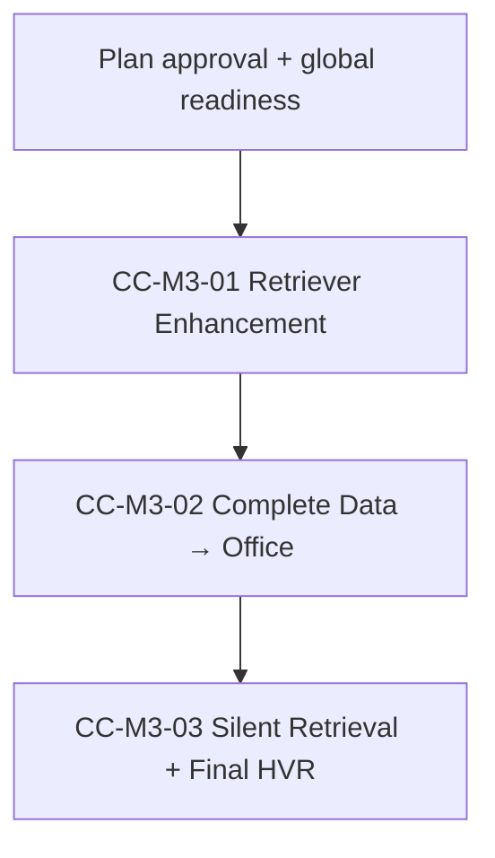

<!--
Template source: office_engine/docs/skill/odoo-project-workflow/references/templates/Planning/IMPLEMENTATION_PLAN_TEMPLATE.md
Template version/status: v0.1 Frozen
Template synchronization check: PASS (2026-11-13)
Frozen v0.3 baseline aligned with TDD v0.4; approval and open-item disposition are recorded as `PLAN-M3-003` in `docs/implementation/AUTHORIZATION_RECORDS.md`.
-->

# Office Engine M3 Implementation Plan v0.3

## Document Information

| Item | Value |
|---|---|
| Document | `IMPLEMENTATION_PLAN_office_engine_m3` |
| Version | `v0.3` |
| Status | **FROZEN WITH OPEN ITEMS — 不授权实施** |
| Baseline validity | **VALID** |
| Project / Module | `odoo18e_llm` / `office_engine` |
| Plan owner | Li Jianqiang (per project authorization register) |
| Created | 2026-11-13 |
| Frozen date | 2026-11-13 |
| Approval / baseline record | `PLAN-M3-003` |

Freeze disposition: `FROZEN WITH OPEN ITEMS`; authorization register: `docs/implementation/AUTHORIZATION_RECORDS.md`; records: `PLAN-M3-003`, `TDD-M3-003`, `CC-M3-02-001`, and the six `EXEMPTION-TDD-M3-V04-*` items listed in the register.

### Revision and Gate Status

Plan v0.3 is frozen and aligned with TDD v0.4. It clarifies that LLM plans business queries while the local Collector only executes a generic plan and checks objective completeness. CC-M3-02 is frozen with OPEN-01b/02/03/04 gates still Missing; the freeze does not grant Coding Authorization.

### Baseline and CC-M3-02 Entry Gate

- [x] M3 SRS applicability: owner-approved N/A; M2 SRS v1.1.0 remains the existing business baseline.
- [x] DDD applicability: owner-approved N/A because M3 adds no new business aggregate or domain state.
- [x] TDD v0.4: owner-approved and frozen with open items under `TDD-M3-003`; current technical baseline.
- [x] Plan v0.3: owner-approved and baselined under `PLAN-M3-003`; current plan baseline.
- [x] CC-M3-01: accepted, closed, and pushed; retained as prerequisite.
- [x] CC-M3-02 v0.2: frozen with OPEN gates under `CC-M3-02-001`; this does not authorize implementation.
- [ ] CC-M3-02: complete the minimum pre-implementation feasibility Spikes for OPEN-01b/02/03/04 before implementation starts. Detailed 148-row, larger-dataset, resource-boundary and output acceptance tests remain implementation work.
- [ ] Before any test, verify the running Odoo process targets only the existing development database `odoo18e_llm`; use synthetic fixtures and transaction rollback. Do not create a database. Environment qualification is not a technical-freeze condition.

**Current baseline:** TDD v0.4 / Plan v0.3 are frozen and authoritative. **CC-M3-01:** complete. **CC-M3-02:** frozen with OPEN gates; no Coding Authorization. OPEN-01b/02/03/04 pre-Spikes remain Missing, and implementation tests remain NOT RUN. No database may be created.

**Evidence references:** `docs/implementation/AUTHORIZATION_RECORDS.md` (`TDD-M3-003`, `PLAN-M3-003`, `CC-M3-02-001`); historical frozen `docs/design/TDD_office_engine_m3_v0.3.md`; current frozen `docs/design/TDD_office_engine_m3_v0.4.md`.

## 1. Upstream Baselines

| Authority / Input | Version / ID | Status | Location |
|---|---|---|---|
| M2 SRS | v1.1.0 | Frozen; applies to existing M2 business semantics | `docs/requirement/SRS_office_engine_m2_ai_mapping_v1.1.0.md` |
| M3 SRS applicability | `DECISION-M3-SRS-NA-001` | Owner-approved N/A: M3 optimizes the existing Office Engine | `docs/implementation/AUTHORIZATION_RECORDS.md` |
| DDD | N/A | Owner-approved: no new domain aggregate/state in M3 | `docs/implementation/AUTHORIZATION_RECORDS.md` (`PLAN-M3-001`); TDD v0.2 §0.2 |
| M2 TDD | v2.1.0 with v2.1.1 and v2.1.2 amendments | Frozen compatibility baseline | `docs/design/TDD_office_engine_m2_v2.1.0_LLM_Native.md` and referenced amendments |
| Historical M3 TDD baseline | v0.3 | Frozen with open items under `TDD-M3-002`; superseded by v0.4 | `docs/design/TDD_office_engine_m3_v0.3.md` |
| Current M3 TDD baseline | v0.4 | Frozen with open items under `TDD-M3-003` | `docs/design/TDD_office_engine_m3_v0.4.md` |
| Historical Implementation Plan | v0.2 | Frozen under `PLAN-M3-002`; superseded by v0.3 | `docs/implementation/IMPLEMENTATION_PLAN_office_engine_m3_v0.2.md` |
| Current Implementation Plan | v0.3 | Frozen / `PLAN-M3-003`; baseline validity `VALID` | `docs/implementation/IMPLEMENTATION_PLAN_office_engine_m3_v0.3.md` | |
| Registry Discovery TV | Current report | Three isolated tests passed; no real Provider round | `docs/verification/TV_Retriever_Registry_Discovery_Report.md` |
| Silent Retrieval TV | Current report | Target not verified; Bus/UI missing and streaming continuation failed | `docs/verification/TV_Silent_Retrieval_Report.md` |
| Retriever query capability review | Read-only source/test review | Pagination envelope, stable order, `in`, and typed errors remain gaps | M3 TDD §0.2 and §§5–6 |
| M2 Route B / Hosted CI TV | Current report | Small XLSX input/output evidenced; multi-page data handoff unverified | `docs/verification/TV_LLM_Native_Excel_Production.md` |

If a frozen upstream baseline changes, mark this plan `IMPACT REVIEW REQUIRED`, stop affected work, and update the baseline and mappings after upstream review.

## 2. Objective and Scope

### 2.1 Objective

Let a user request an Odoo data export in natural language and receive a task-appropriate Excel Candidate through the existing M2 Route B and confirmation lifecycle. The LLM owns intent understanding, model / field selection, relation scope, query plan and output plan. The local Collector executes only the already-determined generic plan, pagination, batch reads and objective completeness checks; it must not implement a local business planner. Hosted Code Interpreter performs workbook creation / editing and complex aggregation or semantic computation. Local validation is limited to objectively verifiable source, handoff, file and version integrity.

### 2.2 In Scope

- Extend the existing `odoo_record_retriever` with generic Registry `discover` / `describe`, compatible `search`, stable pagination and ordering, `in` domains, and structured errors.
- Collect all requested root and direct relation records through the current user's ORM; transfer the complete dataset to the existing Route B / Hosted Code Interpreter path using a carrier proven by an isolated compatibility test.
- Preserve LLM + Hosted Code Interpreter as the Excel content generator/editor for both new and existing workbooks. Local code handles permissions, collection, handoff, integrity checks, versions, and confirmation gates only.
- Preserve the M2 Candidate, Current, Accept, Reject, and Finalize lifecycle.
- Add Silent Retrieval within proven visibility boundaries while retaining audit records, tool context, execution state, and diagnostics.
- Cover 148 records, larger bounded synthetic datasets, relation completeness, error/security cases, and final authorized Agent UI HVR.

### 2.3 Out of Scope

- New public Registry, Batch Query, or report-generation tool; changes to upstream `odoo-llm`; model-specific logic, templates, columns, coordinates, or business rules.
- Local deterministic Excel content generation or repair, replacement of M2 Route B, or changes to M2 general file-edit capability.
- Partial Candidate / Partial Accept, persistent source snapshots, dataset caches, or recursive relationship expansion.
- Production data, Provider calls, deployment, or release without separate scope-specific authorization.

### 2.4 Constraints

- Extend downstream only. Keep `odoo_record_retriever` and `office` as the public tools.
- Do not choose a handoff format before Hosted CI input/output compatibility evidence; do not rely on conversation context to carry or join pages.
- Verify objective source identity / selected-field coverage, handoff, file structure / bytes / SHA and version binding. LLM + Hosted Code Interpreter performs complex aggregation / semantic computation; no local report or calculation engine. If computation cannot be independently checked, retain M2 `PARTIALLY_VERIFIED` / user-review semantics. Completeness and source freshness are distinct; do not repeat a full query by default.
- On collection, transfer, output, integrity, or resource-limit failure, fail closed; do not deliver an incomplete workbook as complete. Ask the user to narrow the scope when needed.
- Keep TDD OPEN statuses and TV results factual. A freeze exemption is not a pass or implementation authorization.

## 3. Readiness and CC-Scoped Gates

Technical design freeze does not require named implementer, reviewer, or test operator. The current `odoo.conf` was checked and points to `odoo18e_llm`; before each test, re-confirm the running process uses this existing development database, use synthetic fixtures with rollback, and confirm any Provider authorization needed for that test. Do not create a database. Formal CC approval and Coding Authorization are required before implementation.

| TDD OPEN / readiness item | Required evidence | Blocks | Current status |
|---|---|---|---|
| OPEN-01a — Domain Schema compatibility | Provider Tool Schema, actual `llm.tool.execute()`, and Odoo ORM accept scalar and list-valued `in` / `not in`; retain end-to-end evidence | CC-M3-01 acceptance, not entry/freeze | Passed; evidence retained in CC-M3-01 ATR and Provider record |
| OPEN-05 — metadata scope | Owner decision: all existing Retriever tool callers may discover Registry model/field Schema; no business ACL, Record Rule, or field-group check; no business records; no `sudo()` | None as a design gate | Closed by owner decision; implementation test remains NOT RUN |
| OPEN-01b — Hosted CI handoff | Pre-CC minimum Spike proves one candidate carrier reaches and is readable by Hosted CI using a synthetic sentinel; implementation acceptance proves 148 and larger bounded complete datasets | CC-M3-02 pre-Spike / acceptance | Pre-Spike Missing; acceptance NOT RUN; carrier undecided |
| OPEN-02 — resource bounds | Pre-CC minimum Spike demonstrates a viable bounded interval and measurable signals; implementation benchmarks establish finite caps and within / boundary / over-limit tests | CC-M3-02 pre-Spike / acceptance | Pre-Spike Missing; caps and acceptance NOT RUN |
| OPEN-03 — transaction/freshness | Pre-CC minimum Spike proves a single cursor / transaction is feasible without page commits; implementation tests verify page / relation read view, concurrent-change behavior and freshness boundary | CC-M3-02 pre-Spike / acceptance | Pre-Spike Missing; runtime and acceptance evidence NOT RUN |
| OPEN-04 — task output verification | Pre-CC minimum Spike proves objective file / identity integrity checks are feasible and defines M2 review status for unverifiable computation; implementation verifies projection, real Hosted CI output, known-fixture aggregate assertions, file / version binding | CC-M3-02 pre-Spike / acceptance | Pre-Spike Missing; implementation tests NOT RUN |
| OPEN-06 — visibility | Test Discuss history, SSE, Bus timing, mixed calls, errors, and streaming disposition | CC-M3-03 entry/acceptance | Bus/UI missing; streaming continuation failed in prior TV |
| Test execution environment | Before each test, confirm exact code/addon/runtime and the existing development DB `odoo18e_llm`; use synthetic fixtures and rollback transactions; do not create a database | Before tests run | No tests executed by this document freeze; environment must be re-confirmed at execution time |

OPEN-01a remains CC-M3-01 acceptance evidence; CC-M3-01 is now closed based on its recorded evidence. OPEN-01b/02/03/04 each have a minimum pre-implementation feasibility Spike, distinct from final CC-M3-02 implementation acceptance. A pre-Spike does not prove 148-row or larger export completeness, production resource caps, all transaction behavior, or task correctness. OPEN-05 is a closed design decision, not a test pass. OPEN-06 remains in CC-M3-03.

## 4. Implementation Stages

CC-M3-01 is completed and closed. CC-M3-02 is frozen with OPEN gates but is not authorized for implementation; CC-M3-03 remains planned and separately gated. CC-M3-02 closes through automated and integration evidence; CC-M3-03 includes the final real UI HVR.

### CC-M3-01 — Retriever Enhancement

**Scope:** Extend the existing Retriever protocol and downstream implementation for Registry discovery, pagination, deterministic sorting, `in` domains, structured errors, and backward compatibility.

**Deliverables:**

- `discover / describe / search` on the existing tool. `discover` uses `_name` / `_description` and returns `_rec_name`; `describe` returns model field names, labels, types, Selection definitions, relation models, and available inverse-field metadata.
- Registry Schema is available to existing Retriever tool callers without business model ACL, Record Rule, or field-group checks. Discovery reads no business records and does not use `sudo()`. `search` and relation queries use the invoking user's ORM permissions.
- Stable page contract (`limit`, `offset`, `count`, `returned_count`, `has_more`, `next_offset`), bounded page size, deterministic ID tie-breaker, and list-valued `in` domains.
- Stable error codes `MODEL_NOT_FOUND`, `FIELD_NOT_FOUND`, `ACCESS_DENIED`, `INVALID_QUERY`, `QUERY_FAILED`; successful zero visible rows remain distinct from an error.
- Old calls without `operation` and their prior successful response shape remain compatible.

**Dependencies / status:** CC-M3-01 is already closed under its approved CC and Coding Authorization; Provider Schema / actual Tool Execute / ORM compatibility evidence is recorded in its ATR. No further CC-M3-01 implementation is proposed here. CC-M3-02 and CC-M3-03 remain separately gated. Tests, when authorized, must use the existing `odoo18e_llm` database only; do not create a database.

**Recorded acceptance:** CC-M3-01 acceptance, including Provider Schema / Tool Execute / ORM compatibility and the agreed Retriever regression scope, has been completed and closed; see its ATR and preserved Provider evidence. Registry Discovery TV remains scoped feasibility evidence only, and no autonomous Agent UI pass is inferred from that TV.

### CC-M3-02 — Complete Data → Office

**Scope:** LLM understands the user's intent and determines the model, fields, relations, query and output plan. Add a generic deterministic Collector that executes that plan, paginates, batches relation reads and checks completeness; deliver the full bounded dataset to existing Route B; let LLM + Hosted Code Interpreter generate/edit Excel and perform complex aggregation / semantic computation. Local checks cover objective source / handoff / file / version integrity, then reuse the M2 Candidate lifecycle. No local business planner, report generator or calculation engine.

**Deliverables:**

- Server-side page loop, de-duplication, deterministic termination, counts and identity checks; batch direct relation queries for multiple parents using `in`, preserving every parent-child pair. No page memory or record concatenation by the Agent.
- All collection queries use the verified read view. Record source-view/freshness metadata separately from completeness; do not default to a second full read.
- A format-neutral handoff contract and the smallest carrier supported by the OPEN-01b Hosted CI Spike. Transfer the entire bounded dataset through the existing Route B request. Extend downstream only; do not edit upstream `odoo-llm` or add another Adapter/tool.
- Route B retains M2 new-workbook and existing-workbook editing. LLM + Hosted CI authors workbook content; local code performs no Excel content generation or repair.
- Local checks cover objective source identities, explicitly selected fields when objectively readable, handoff counts / digests, workbook readability / structure / bytes / SHA and version binding. Hosted Code Interpreter computes aggregate and semantic outputs. Test fixtures may assert known expected constants for a fixed synthetic case; production runtime must not recalculate complex results locally. If the task computation is not independently verifiable, keep the existing M2 `PARTIALLY_VERIFIED` / user-review level and do not claim independent proof.
- Register a complete M2 Candidate only after all checks pass; preserve Current, Accept, Reject, Finalize, version binding and confirmation gates. No Partial Candidate.

**Dependencies / entry gate:** CC-M3-01 accepted; CC-M3-02 is frozen under `CC-M3-02-001` and still requires separate Coding Authorization. Before implementation, complete only the minimum feasibility Spikes for OPEN-01b/02/03/04. Their larger and final acceptance evidence is gathered during this CC. OPEN-06 does not block this CC.

**Acceptance and evidence:** During implementation, automated and integration tests demonstrate full transfer and output for 148 rows across 100 + 48 pages and a larger bounded dataset, with no missing / duplicate identities; batched child pairs are complete; Hosted CI can actually read the selected carrier and returns the XLSX; objective projection identity / selected-field checks, handoff digests, file integrity and output SHA / receipt / version binding pass. Fixed synthetic aggregate cases may be checked against precomputed expected constants; no generic local calculator is added. Complex production semantics not independently verified remain at the existing M2 review level. Resource, page, transfer, and file-integrity failures never create a complete Candidate; supported new/edit Route B cases and Accept / Reject / Finalize / M2 regression pass. Use synthetic data and only existing `odoo18e_llm` for tests, under separate Provider authorization. These tests do not substitute for final Agent UI HVR.

### CC-M3-03 — Silent Retrieval + Final HVR

**Scope:** Implement and verify Silent Retrieval across Discuss, SSE, and Bus, then run the complete authorized Odoo UI → Agent → Retriever → Office → Excel → Accept → Finalize HVR and M2 regression.

**Deliverables:**

- Classify at creation time so a successful pure Retriever message is suppressed before Bus notification and excluded from user-facing Discuss/SSE views while retained in `mail.message`, tool call/result records, LLM context, execution state, and diagnostics.
- Keep final answers, clarifications, failures, confirmations, Office operations, and any mixed assistant message containing a non-Retriever tool visible. Never hide an entire mixed message.
- Exercise streaming continuation. The earlier streaming failure and limited GPT-5 non-streaming mock/ORM evidence are not passes. An unverified path remains visible or outside the claimed silent scope; do not change upstream code.
- Produce HVR, independent downloaded workbook readback, ATR, and M2 regression evidence.

**Dependencies / entry gate:** CC-M3-01 and CC-M3-02 accepted; OPEN-06 closed for each path claimed silent; isolated Odoo UI environment, browser, fixture and separate real-Provider/HVR authorization. Unverified streaming may remain visible only if the HVR explicitly tests and documents that boundary.

**Acceptance and evidence:** Automated message lifecycle, Bus, SSE, Discuss-history, mixed-tool, error, and context/audit-retention tests pass. Final HVR starts with a business name alone and verifies that the Agent discovers the appropriate model, fields, and relationships before following the full user-visible flow. The final workbook contains all 148 expected identities exactly once (including relation checks where requested), is independently read back, matches its verification receipt/SHA, and completes Accept and Finalize. M2 behavior and old retriever calls regress successfully. No homepage screenshot, command-line redirect, isolated mock, or integration test alone counts as this HVR.

## 5. Order and Milestones

| Milestone | Exit evidence | Status |
|---|---|---|
| Current baseline readiness | Frozen TDD v0.4 / Plan v0.3 are valid; CC-M3-02 is frozen but requires pre-Spikes and separate Coding Authorization before implementation | Baselines valid; CC-M3-02 implementation blocked |
| CC-M3-01 | Retriever contract, security, schema, paging, errors, and legacy tests pass | Closed; evidence recorded |
| CC-M3-02 | Minimum OPEN-01b/02/03/04 feasibility Spikes before implementation; full source → handoff → Hosted CI output, objective integrity, and M2 lifecycle tests during implementation | Frozen with OPEN gates; implementation not started; no Coding Authorization |
| CC-M3-03 | Silent visibility tests and full authorized UI HVR, 148-record readback, Accept/Finalize, M2 regression | Not started |

No dates or effort estimates are assigned; staffing and target dates are unknown. Each CC requires its own freeze and Coding Authorization. CC-M3-01 has been authorized by the owner; later CCs remain unauthorized until separately approved.

## 6. Acceptance and Verification Matrix

CC-M3-01 is closed with its recorded evidence. CC-M3-02 and CC-M3-03 implementation work has not run; their planned evidence remains Missing / NOT RUN.

| CC | Required acceptance | Verification / evidence | Current evidence status |
|---|---|---|---|
| CC-M3-01 | Registry discovery / description; Provider / Tool / ORM `in` compatibility; secure ORM reads; deterministic pagination / sort; typed errors vs zero; legacy compatibility | Unit + TransactionCase + actual Tool Execute; Provider evidence and ATR | Closed; retained as prerequisite evidence |
| CC-M3-02 | LLM planning; generic server-side collection / relation batching; full handoff; Hosted CI workbook / complex computation; objective source, file and version integrity; M2 Candidate lifecycle | Pre-entry feasibility Spikes; then implementation tests for synthetic 148 (100+48), larger bounded fixture, output readback, identities / relations, receipt / SHA and M2 regression | Pre-Spikes Missing; implementation NOT RUN. Multi-page Hosted CI handoff unverified |
| CC-M3-03 | Pre-notify Bus suppression; Discuss/SSE/history behavior; mixed/error/clarification/confirmation visibility; audit/context retention; streaming claim boundary; full UI HVR and M2 regression | Odoo integration + Bus/SSE tests; authorized built-in browser HVR; downloaded file independent readback; ATR/HVR/FR evidence | NOT RUN / Missing. Silent Retrieval target not verified; Bus/UI missing and streaming continuation failed |

## 7. Verification Strategy

| Area | Evidence required |
|---|---|
| Automated / ORM / integration | Each CC records test commands, code/addon identity, existing `odoo18e_llm` database identity and native result in ATR. CC-M3-02/03 automation and integration evidence is a prerequisite to its FR; CC-M3-01 evidence is already recorded. |
| Security | Registry Schema is not filtered by business ACL, Record Rules, or field groups and reads no business records. Verify current-user ACL, Record Rules, company context, and field access for `search` / related reads only. Never use `sudo()`. |
| Hosted CI and file integrity | Authorized synthetic-data tests using the existing `odoo18e_llm` development DB only before final HVR; retain input/output lineage, counts, task-profile checks, real file readback and SHA. A readable XLSX alone does not establish completeness. |
| Capacity and failure behavior | Synthetic benchmarks determine finite OPEN-02 limits. Inject page, relation, payload, Provider, output, and validator failures; no truncation or complete Candidate on failure. |
| UI / human verification | CC-M3-03 uses the current-session built-in browser on an authorized non-production Odoo. HVR records actual screen actions and independently inspected downloaded file. |
| Upgrade and regression | Isolated addon install/upgrade/rollback rehearsal, selected and required M1/M2 suites, Route B and lifecycle regression; preserve M2 version history. |

Prior TV evidence does not authorize a Provider call, external data transfer, database operation, or UI HVR. Obtain separate authorization for those actions.

## 8. Risks and Contingencies

| Risk | Impact | Mitigation / response | Gate |
|---|---|---|---|
| Provider/Tool Execute/ORM rejects `in` arrays or Retriever schema | CC-M3-01 cannot meet its acceptance contract | Implement within the approved schema design; run all three compatibility checks as CC-M3-01 acceptance. Failure blocks CC closure; if the contract proves infeasible, stop and return to TDD review | CC-M3-01 |
| Registry Schema is mistaken for business-data access | Agent assumes metadata grants record access | Explicitly separate public-to-tool-callers Registry Schema from current-user ORM `search`; no records or `sudo()` in discovery | CC-M3-01 |
| No allowed Route B carrier transports the complete bounded dataset | Export cannot be complete | Prove handoff in Hosted CI TV; no transcript fallback or local Excel writer; if downstream extension cannot satisfy it, stop and revise TDD | CC-M3-02 |
| Resource or transaction limits prevent complete collection | Truncated/stale source data | Measure finite caps; verify same read view and freshness semantics; fail or ask user to narrow scope | CC-M3-02 |
| Complex task output cannot be independently recomputed locally | False claim of correctness | Keep local checks objective; Hosted CI performs task computation; retain M2 `PARTIALLY_VERIFIED` / user-review status where computation cannot be independently verified; do not build local calculator | CC-M3-02 |
| Silent message leaks or hides a needed message | User-visible noise or lost errors/confirmation | Test create-time Bus ordering, history, SSE and mixed calls; keep unverified streaming visible | CC-M3-03 |

## 9. Resources and Environments

| Resource | Requirement / status |
|---|---|
| Odoo test environment | Use only the existing development database `odoo18e_llm`; confirm exact Odoo/addon/runtime, synthetic fixtures, transaction rollback and any required authorization before tests. Do not create a database |
| Hosted Code Interpreter / Provider | Current Route B path and measured input/output limits; multi-page handoff missing; each call needs separate authorization |
| HVR browser | Current-session built-in browser with authorized non-production login; availability to verify before CC-M3-03 |
| Fixtures | 148 roots, larger bounded dataset, multi-parent relation graph, permission/error cases; not yet prepared |
| Roles | Implementation, review, test, environment, and HVR assignments are operational planning details; they are not technical-freeze gates and may be confirmed when work is scheduled |

## 10. Change Control

- New independent business behavior returns to the owner for SRS applicability/change review; M3 SRS N/A does not pre-approve scope growth.
- A change to frozen M2/M3 TDD stops affected work. Obtain upstream approval, version the TDD, then update this plan and mappings before resuming.
- If evidence shows Route B cannot accept the complete handoff through the permitted downstream boundary, stop CC-M3-02 and return to TDD review. Do not modify upstream `odoo-llm`, add a second Adapter, or substitute a local writer.
- Every CC requires its own scope review and Coding Authorization. The plan does not authorize code, Provider use, data egress, database mutation, deployment, or release.
- Preserve original failed, missing, and skipped evidence; do not claim capability beyond the tested scope.

## 11. Deliverables and Project Handoff

| Deliverable | CC | Completion evidence | Status |
|---|---|---|---|
| Retriever Registry/query contract and regression suite | CC-M3-01 | Schema, ORM, permission, paging, error, and legacy-call ATR | Planned |
| Deterministic collection, verified Route B handoff, XLSX Candidate and lifecycle | CC-M3-02 | Full source/handoff/output evidence; Hosted CI workbook readback; M2 lifecycle ATR | Planned |
| Silent Retrieval plus full UI HVR and M2 regression | CC-M3-03 | Bus/SSE/Discuss ATR; full-flow HVR; 148 identities and file SHA; Accept/Finalize record | Planned |

At project closure, reconcile each deliverable to its CC, IHR/ATR/HVR, FR and PVR. This plan does not replace requirement coverage or project closure review.

## 12. Open Decisions and Follow-up

| TDD OPEN / plan item | Required disposition | Blocking CC | Current status |
|---|---|---|---|
| OPEN-01a — Domain Schema compatibility | Provider Tool Schema, actual Tool Execute and ORM evidence for scalar and `in` arrays | CC-M3-01 acceptance | Passed; evidence retained in CC-M3-01 ATR / Provider record |
| OPEN-05 — Registry metadata exposure | Owner decision allows Registry Schema discovery independent of business ACL / Record Rules / field groups; no business records and no `sudo()` | None as design gate | Closed by owner instruction; TEST-RET-002 remains NOT RUN |
| OPEN-01b — Hosted CI handoff | Pre-CC minimum sentinel carrier-readability Spike; implementation acceptance for 148 and larger bounded complete datasets | CC-M3-02 | Pre-Spike Missing; acceptance NOT RUN; `EXEMPTION-TDD-M3-V04-OPEN-01B-001` |
| OPEN-02 — Resource budgets | Pre-CC viable bound / measurable signals Spike; implementation benchmarks and within / boundary / over-limit tests | CC-M3-02 | Pre-Spike Missing; caps NOT RUN; `EXEMPTION-TDD-M3-V04-OPEN-02-001` |
| OPEN-03 — Read view and freshness | Pre-CC same-cursor feasibility Spike; implementation acceptance for relation / concurrent-change read view and freshness | CC-M3-02 | Pre-Spike Missing; runtime acceptance NOT RUN; `EXEMPTION-TDD-M3-V04-OPEN-03-001` |
| OPEN-04 — Output verification | Pre-CC objective file / identity check feasibility and M2 review-level agreement; implementation projection / hosted output / fixture aggregate / file-version tests | CC-M3-02 | Pre-Spike Missing; implementation NOT RUN; `EXEMPTION-TDD-M3-V04-OPEN-04-001` |
| OPEN-06 — Silent Retrieval | Verify Bus, SSE, Discuss/history, mixed messages, errors and streaming boundary | CC-M3-03 | Bus/UI Missing; streaming Failed; `EXEMPTION-TDD-M3-V04-OPEN-06-BUS-001` / `EXEMPTION-TDD-M3-V04-OPEN-06-STREAM-001` |
| Environment qualification | Confirm isolated environment and authorization before test execution; do not gate technical freeze on names or environment readiness | Before any test | Not checked here; no tests run |

These are the frozen dispositions under TDD v0.4 and Plan v0.3 (`TDD-M3-003`, `PLAN-M3-003`). CC-M3-01 is closed. CC-M3-02 is frozen with OPEN gates but remains unauthorized for implementation; pre-Spikes and implementation tests retain Missing / NOT RUN status. Tests, when separately authorized, must use only the existing development database `odoo18e_llm`; do not create a database or mark unrun evidence Passed.

## 13. Traceability

### 13.1 Authority to Plan

| Authority / evidence | Planned CC | Coverage |
|---|---|---|
| M2 SRS v1.1.0 and M3 SRS N/A decision `DECISION-M3-SRS-NA-001` | CC-M3-01–03 | Preserve current business semantics; no separate M3 SRS baseline |
| M2 TDD v2.1.0 with v2.1.1/v2.1.2 amendments | CC-M3-01–03 | Preserve existing tools, Route B, file/version behavior, confirmation and Candidate lifecycle |
| Frozen M3 TDD v0.4 §§5–6 | CC-M3-01 | Registry, query contract, pagination, ordering, domains, errors and compatibility |
| Frozen M3 TDD v0.4 §§6–12 | CC-M3-02 | LLM planning boundary, generic collection, relations, handoff, objective integrity, resource/security boundaries |
| Frozen M3 TDD v0.4 §13 | CC-M3-03 | Silent message lifecycle, SSE/Discuss/Bus and visibility boundaries |
| Frozen M3 TDD v0.4 §§14, 18, 20 | CC-M3-01–03 | Test matrix, feasibility gates, OPEN items and evidence status |
| Registry Discovery TV / retriever read-only review | CC-M3-01 | Reuse only scoped evidence; run actual Tool Execute, ORM and compatibility tests |
| M2 Route B TV and `ResponsesAdapter.execute()` | CC-M3-02 | Preserve LLM + Hosted CI authoring; prove full-data handoff before export claim |
| Silent Retrieval TV | CC-M3-03 | Bus/UI gap and streaming failure remain explicit entry/acceptance evidence |

### 13.2 Plan to Coding Closure

| Planned CC / scope | IHR / ATR / HVR | FR | Project evidence |
|---|---|---|---|
| CC-M3-01 — Retriever Enhancement | Closed; IHR / ATR and Provider evidence recorded | Completed | Final M3 PVR |
| CC-M3-02 — Complete Data → Office | Frozen with OPEN gates; implementation not authorized | Planned | Final M3 PVR |
| CC-M3-03 — Silent Retrieval + Final HVR | Planned; not created | Planned | Final M3 PVR |

## 14. Change History

| Version | Date | Status | Change and reason | Baseline |
|---|---|---|---|---|
| v0.1 | 2026-11-13 | Frozen | Owner approved the three-CC plan and DDD N/A applicability; scoped TDD OPEN gates by CC. First CC remains blocked by its own technical/environment gates | `PLAN-M3-001`; baseline valid |
| v0.2 | 2026-11-13 | Frozen | Align plan with frozen TDD v0.3 and owner metadata decision; move Domain Schema three-layer verification to CC-M3-01 acceptance, close OPEN-05 design gate, retain Hosted CI Spike before CC-M3-02, and restrict tests to existing `odoo18e_llm` database. Approved / baselined under `PLAN-M3-002` | `PLAN-M3-002`; baseline valid |
| v0.3 | 2026-11-13 | Frozen with open items | Clarify LLM-owned query / relation / output planning, generic Collector execution, objective-only local integrity checks, Hosted CI computation, and split feasibility Spikes from implementation acceptance. Freeze record `PLAN-M3-003`; implementation gates remain open | `PLAN-M3-003`; baseline validity VALID |
