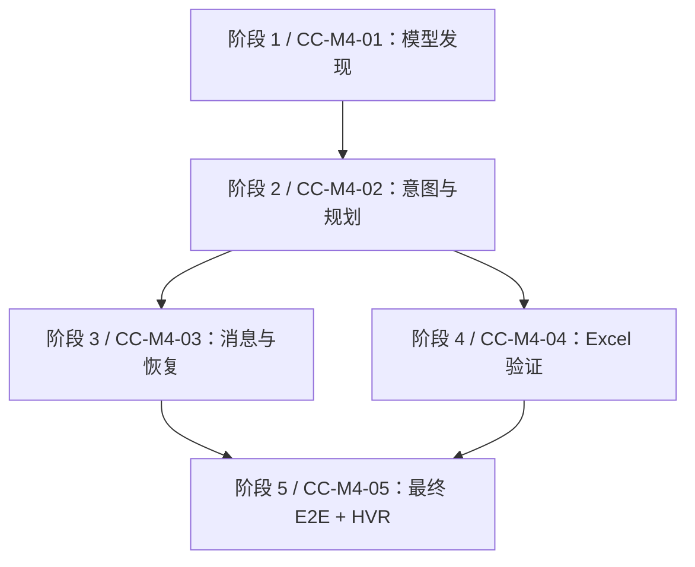

<!--
模板来源：office_engine/docs/skill/odoo-project-workflow/references/templates/Planning/IMPLEMENTATION_PLAN_TEMPLATE.md
模板版本/状态：v0.1 Frozen；已与项目工作流同步。
本计划经项目负责人批准并于 2026-11-18 冻结；冻结不等同实施授权或 CC 创建授权。
-->

# Office Engine M4 实施计划 v0.1

## 文档信息

| 项目 | 内容 |
|---|---|
| 文档 | `IMPLEMENTATION_PLAN_office_engine_m4` |
| 版本 | `v0.1` |
| 状态 | **FROZEN — 2026-11-18** |
| 基线有效性 | **VALID** — 引用已冻结的 TDD v0.2 |
| 项目 / 模块 | `odoo18e_llm` / `office_engine` |
| 计划负责人 | 项目负责人（评审时确认） |
| 起草日期 | 2026-11-18 |
| 基线日期 | 2026-11-18 |
| 批准 / 基线记录 | 项目负责人于 2026-11-18 在本会话批准；本文件记录为 v0.1 冻结基线 |

### 冻结门禁

本计划在 TDD v0.2 冻结后起草，经项目负责人评审批准并于 2026-11-18 冻结。五个实施阶段及拟建 CC 映射构成本计划基线；冻结本计划不创建 CC，也不授权编码、Provider 调用、数据库写入或发布。

### 首个 CC 前门禁清单

- [x] **SRS 适用性：** SRS v1.1.0 保持冻结且未修改。本项目 M4 范围按冻结 TDD v0.2 §0.3 中项目负责人明确的决定执行；不为未授权的治理功能新增 SRS 修订任务。
- [x] **DDD 适用性：** N/A。M4 复用现有 Thread、Retriever、Office 和版本概念；冻结 TDD 未增加业务聚合。
- [x] **TV / Spike 处置：** M4 TV 与 TD-M4-002～004 的 Spike 结果均有记录。原有 PASS / FAIL / UNKNOWN 状态保持不变；未解决技术细节和能力失败项映射至下列 CC 修复并复测。
- [x] **TDD：** `TDD_office_engine_m4_v0.2.md` 于 2026-11-18 冻结，状态为 FROZEN WITH OPEN ITEMS。剩余事项属于实施与验证工作，不阻断 TDD 冻结。
- [x] **计划批准：** 项目负责人已于 2026-11-18 批准并冻结本 v0.1。
- [x] **阶段 / CC 映射：** 每个阶段均映射至拟建的 CC-M4-01～CC-M4-05。它们目前只是拟建编号，尚未创建 CC。
- [x] **未通过项处置：** M4 TV 的失败仍为失败，不豁免、不改写。项目负责人已批准将其作为对应 CC 中的修复与复测任务；不把原失败改写为通过。

**门禁结论：** **上游计划门禁 READY。** TDD 与计划均已冻结，M4 TV 失败项已有获批的 CC 修复 / 复测处置；这只表示可进入后续 CC 契约评审，不代表本次已创建 CC 或取得编码授权。

## 1. 上游基线

| 权威输入 | 版本 / 编号 | 状态 | 位置 |
|---|---|---|---|
| SRS | `SRS_office_document_automation_v1.1.0` | 冻结的历史基线；M4 适用范围按 TDD §0.3 的负责人决定执行 | `office_engine/docs/requirement/SRS_office_document_automation_v1.1.0.md` |
| DDD | N/A | 不触发：TDD v0.2 未增加业务聚合或持久化业务领域状态 | 本计划记录；参见 TDD §§3、13 |
| M4 TV / RCA | TV Closure；RCA-001～008；2026-11-18 针对性 TV 复测 | 已记录关闭结果 PASS / FAIL / UNKNOWN；失败状态保留事实 | `office_engine/docs/verification/M4_TV/` 和 `office_engine/docs/verification/m4_rca/` |
| TD-M4-001 | 负责人范围决定，2026-11-18 | 已决定：当前 M4 面向 Office Agent 能力，并保留现有安全机制 | TDD §0.3；`M4_SRS_Scope_Alignment_Report.md` |
| TD-M4-002～004 | 三份 Spike 报告 | 已有证据；剩余实施细节分配至 CC-M4-01 / 03 / 04 | `office_engine/docs/verification/M4_TV/SPK-M4-*_Report.md` |
| M2 TDD | v2.1.0 及已批准修订 | 冻结的兼容性基线 | 参见 TDD v0.2 §0.2 |
| M3 TDD | v0.4 及 2026-11-16 实施兼容性 Addendum | 带开放项冻结；作为 Retriever、Collector、Silent Retrieval 和 Candidate 的当前基线 | `office_engine/docs/design/TDD_office_engine_m3_v0.4.md` 及 Addendum |
| M4 TDD | v0.2 | **FROZEN WITH OPEN ITEMS**；负责人于 2026-11-18 批准冻结 | `office_engine/docs/design/TDD_office_engine_m4_v0.2.md` |

本计划只基于以上冻结基线。若要改变任何 M2 / M3 冻结契约或 M4 TDD 技术方向，须先按对应文档流程完成评审和版本更新，再评估本计划的影响。

## 2. 目标与范围

### 2.1 目标

解决 M4 TV 暴露的 Agent 能力缺口，使普通业务员可以通过自然语言提出任务，由 Agent 正确继承当前任务意图和约束，自主发现业务对象、规划并协同现有工具、检查结果、恢复可恢复的错误，最终交付可验证的正确业务结果。

最终验收以业务目标和结果正确为准；工具调用成功、Collector 收到数据或 XLSX 文件生成成功，均不能单独判 PASS。

### 2.2 范围内

- 通用 Registry 业务对象候选发现、字段与关系理解；不新增公开工具，不针对具体模型、字段或词语硬编码。
- 自然语言意图理解、当前任务约束继承、动态查询与输出规划，以及 Retriever 契约和旧调用兼容。
- 最终回复持久化与可见性、错误分类理解，以及按操作副作用区分的有界恢复。
- 由 LLM + Hosted Code Interpreter 生成 Excel；确定性程序负责明细、公式 / 聚合和文件完整性的任务适配验证。
- 通过真实 Odoo UI 完成 Agent → Retriever → Office → Candidate → 人工 Accept → Finalize 的完整业务验收。
- 保留 Odoo ACL、Record Rules、当前已有且必要的字段访问控制、文件完整性、版本 SHA 和用户确认门禁。

### 2.3 范围外

- 企业级白名单配置审批、策略版本管理、额外字段审批流程、独立审计管理平台、审计审批工作流或其他额外治理机制；不规划 M5 治理阶段。
- M5 式完整上下文分类 / 分级管理、跨任务长期记忆、历史会话语义整理或附件优先级管理。M4 只保证当前任务意图及相关澄清 / 约束在本次执行链中正确继承。
- 新增独立 Registry / Batch / 报表 Tool，或改变上游 `odoo-llm` 公共接口。若 CC-M4-03 确认缺陷位于框架内部，允许在单独获批的 CC 范围内修复内部实现，但必须保持公共接口兼容并通过适用的 M2 / M3 回归。
- 本地业务规划器、Excel 内容 Writer、复杂报表 / 计算引擎，或替代 M2 Route B / Hosted Code Interpreter。
- 修改 M2 / M3 冻结行为、放宽权限、增加 `sudo()`、直连 SQL / Odoo RPC，或绕过 Candidate / Accept / Finalize。
- 生产环境操作、部署、发布及本计划以外的功能。

### 2.4 约束

- 只使用现有开发数据库 `odoo18e_llm`；不得新建数据库或访问生产环境。数据库、Provider、Hosted CI 和浏览器等环境须在相应 CC 执行前，按其授权与验收范围确认。
- 保持现有两个公开工具 `odoo_record_retriever` 与 `office`；保留 M2 / M3 对外契约和用户确认语义。
- 框架内部缺陷可以在确认根因后修复，但不得改变 `odoo-llm` 公共接口；须在 CC 中记录兼容性影响、回归证据和授权范围。
- 不得向受测 Agent 注入隐藏 Oracle 中的业务模型、字段、Domain、身份集和正确结果；不得要求 Agent 暴露隐藏思维链。
- 中间 CC 以自动化测试和组件集成证据验收；最终真实 UI HVR 与人工验收只在 CC-M4-05 完成。
- 所有方案必须通用。未验证结果如实记录为 FAIL、部分验证或未验证。

## 3. 开工准备

| 前置项 | 要求状态 / 证据 | 负责人 | 优先级 | 状态 |
|---|---|---|---|---|
| SRS 适用性 | SRS 冻结；M4 范围按冻结 TDD v0.2 §0.3 中负责人决定执行 | 项目负责人 | P0 | 已决定 |
| DDD 适用性 | 不增加业务聚合或状态；本计划和 TDD 已记录 N/A 理由 | 项目负责人 / 评审人 | P0 | N/A |
| TDD 基线 | v0.2 已冻结；剩余实施细节分配至 CC | 项目负责人 | P0 | 完成 |
| 计划基线 | v0.1 已获项目负责人批准并冻结，包含 CC 映射和 M4 TV 失败项处置 | 项目负责人 | P0 | 已完成 |
| 现有开发环境 | 仅使用数据库 `odoo18e_llm`；各 CC 开工前确认 Odoo / addon 进程和测试账号；不得新建数据库 | 环境负责人 | 执行 CC 前 P0 | CC 前确认 |
| 测试数据 | 每个 CC 定义经批准的合成数据或现有开发数据，并明确清理 / 回滚方式；不得使用生产数据 | CC 负责人 / 测试负责人 | 每个 CC 的 P0 | CC 内准备 |
| Provider / Hosted CI | CC-M4-05 使用已授权的 OpenAI GPT-5.6 Luna（`gpt-5.6-luna`），并确认已选择 `odoo_record_retriever` 与 `office` | Provider / 测试负责人 | CC-M4-05 的 P0 | CC 前确认 |
| 浏览器 / 人工验收 | 使用当前会话内置浏览器；需有可通过 Odoo UI 审阅并接受 Candidate 的业务用户 | HVR 负责人 / 业务用户 | CC-M4-05 的 P0 | CC 前确认 |

运行环境准备未完成，不影响 TDD 或本计划基线；它只阻止依赖该资源的 CC 开始或相应验收。

## 4. 实施阶段

### 阶段 1：通用业务对象发现 — CC-M4-01

**目标**

让 Agent 能从多语言、长短及同义自然语言表达中发现正确的 Registry 候选；当业务含义仍有实质歧义时，避免擅自选错。

**输入与依赖**

- 冻结 TDD v0.2 §§1.2、5.1、14（TD-M4-002）；`SPK-M4-DISCOVERY-01_Report.md`。
- 现有 `odoo_record_retriever.discover / describe`；不得增加公开 Registry Tool。

**计划范围与交付物**

- 面向当前完整 Registry 做通用候选召回、排序和歧义处理；按 TDD 冻结的方向，以语义候选发现为主，可配置别名作为可选补充。
- 建立多模型盲测集，覆盖中英文、短词、长句、单复数、同义表达和业务歧义；不向 Agent 暴露技术模型名或字段名。
- 记录正确候选召回、Top-k 排序、误候选、澄清行为和性能；在 CC 冻结时先明确可量化验收阈值。
- 交付通用实现、自动化组件测试、集成测试及相应 IHR / ATR。原型和 TV 小样本结果不得冒充产品能力。

**验收门禁**

- 不针对盲测词语或模型编写硬编码规则，所有表达均经通用发现路径处理。
- 明确意图对应的正确模型进入候选并能被 Agent 选中；对会改变结果的业务歧义能够澄清，不把歧义候选说成唯一正确项。
- 按 CC 预先冻结的召回、误候选、歧义和性能阈值，通过自动化和组件集成测试。
- 现有 `discover / describe / search` 工具边界，以及元数据发现与业务记录权限分离不回归。

**验证证据**

- 盲测集定义 / 哈希、排序与歧义指标、延迟记录、自动化测试输出、Registry 集成 ATR 和权限回归证据。

**CC 映射**

- 拟建 CC-M4-01。**中间 CC：只以自动化和组件集成测试验收，不执行 UI HVR。**

### 阶段 2：意图理解与任务规划 — CC-M4-02

**目标**

让 Agent 在当前任务执行过程中完整保留原始意图及后续澄清中的业务约束，动态形成可执行的查询 / 输出计划，并明确区分查询错误与合法零结果。

**输入与依赖**

- CC-M4-01 提供的通用发现接口与候选结果。
- TDD §§4.1、4.3、5.2、7、9；TV C02 / E05 / E07 相关证据。

**计划范围与交付物**

- 从当前任务和相关澄清提取可观察的业务约束，建立“用户条件 → 模型 / 字段 / 关系 → Retriever 参数 → 结果 / 输出检查”的追溯关系。
- 用户最新的明确指令优先于与之冲突的历史任务要求、Agent 旧计划和工具输出；用户只修改部分条件时，未修改条件继续有效。多轮工具调用不得丢失当前用户目标及约束。
- Agent 可依据 Registry / 查询回执动态调整后续计划；不要求第一次调用前生成静态全计划，也不记录隐藏思维链。
- 对 `search(query=...)` 等 operation 不适用参数，按 TDD 契约明确拒绝并复用现有错误码；保留省略 `operation` 的 legacy search 调用和响应兼容。
- 只保证当前任务意图 / 约束在当前执行链中的继承；不构建跨任务或历史会话完整上下文分类系统。
- 交付自动化计划 / 约束覆盖测试、Provider Tool Schema 与 Tool Execute / ORM 组件集成测试、旧调用回归以及 IHR / ATR。

**验收门禁**

- 受测 Agent 只收到自然语言任务、必要澄清和实际工具返回；不预先提供模型、字段或 Domain。
- 每项明确的业务约束均可追溯到计划、查询 / 工具结果及最终输出检查；不得静默丢弃或放宽条件。
- 冲突测试须证明用户最新明确指令覆盖旧要求、计划或工具输出；部分修改时其余有效约束仍被保留，执行链中不能丢失当前任务目标。
- Agent 能利用新信息动态调整计划；若业务含义无法唯一确定且会改变结果，必须向用户澄清。
- `search(query=...)` 不再被静默忽略；legacy 调用保持兼容，权限错误与零结果语义不混淆。

**验证证据**

- 约束覆盖矩阵、Provider Schema / Tool Execute / ORM 集成结果、legacy 调用回归 ATR 和查询结果 Oracle 对照。

**CC 映射**

- 拟建 CC-M4-02。**中间 CC：只以自动化和组件集成测试验收，不执行 UI HVR。**

### 阶段 3：最终消息与失败恢复 — CC-M4-03

**目标**

确保最终结果、澄清和失败说明可靠持久化并对用户可见；让 Agent 按操作副作用和错误类别进行有限且安全的恢复。

**输入与依赖**

- TDD §§6、7、9、14（TD-M4-003、006）；`SPK-M4-MESSAGE-01_Report.md`；Thread 866 证据。
- CC-M4-02 定义的错误与约束追溯契约。

**计划范围与交付物**

- 沿 Provider SDK 响应、现有 Odoo 消息处理、`mail.message`、Silent Retrieval、Bus / SSE 与 Discuss 可见性链路定位 Thread 866 的内部中断点。根因若位于 `odoo-llm` 框架内部，可在单独获批的 CC 范围内修复内部实现；不得改变公共接口，且须验证 M2 / M3 兼容性。
- 成功的纯 Retriever 内部消息仍按 M3 静默规则处理；最终答复、澄清、失败、Office / 混合调用及确认消息不得误隐藏。
- 按 TDD 的副作用分类恢复：只读发现 / 查询允许有界纠错；权限拒绝不通过更换身份恢复；写操作状态未知时先检查状态 / 版本，不盲目重发。
- 复用现有消息、工具记录和必要诊断；不新增审计管理、审批流或独立治理模型。
- 交付消息持久化、SSE / Bus 分类、错误恢复与故障注入的自动化 / 组件集成测试以及 IHR / ATR。

**验收门禁**

- 非流式路径的最终答复在广播前持久化，刷新 / 重开后仍可见；最终失败消息不会被 Silent Retrieval 隐藏。
- 按 M3 已验证范围处理流式路径可见性；不要求修复上游 generator 续接。未覆盖的流式行为如实标为未验证。
- 错误类别、Agent 实际收到的回执和后续行为可观察；不得绕过权限，写操作状态未知时不得盲目重试。
- Office / 混合工具消息不会仅因包含 Retriever 而被整条丢弃。
- 若修复触及框架内部代码，既有 Provider / Tool 公共契约保持兼容，受影响的 M2 / M3 回归通过。

**验证证据**

- 请求 / Thread / 消息关联证据、`mail.message` 持久化断言、Bus / SSE 和历史查询测试、故障注入 ATR、重试决策矩阵。

**CC 映射**

- 拟建 CC-M4-03。**中间 CC：只以自动化和组件集成测试验收，不执行 UI HVR。**

### 阶段 4：Excel 结果验证 — CC-M4-04

**目标**

让输出验证区分明细记录完整性、公式 / 聚合正确性和文件 / 版本完整性；避免把公式工作表误判为明细身份失败，也不把无法验证的语义结果宣称为已验证。

**输入与依赖**

- TDD §§5.3、9、12、14（TD-M4-004、007）；`SPK-M4-AGGREGATION-01_Report.md`。
- M3 `export_verification.py`、Route B / Hosted Code Interpreter、Candidate 与 SHA 门禁。

**计划范围与交付物**

- 分别设计并实现明细投影、明细加汇总、纯聚合输出的任务适配验证。
- 用独立且对 Agent 隐藏的 Oracle 核对源身份、数量、字段 / 关系和可客观表达的汇总结果；验证器回执须能被 Agent 读取。
- 处理公式单元格与缓存值；如需重算，只在隔离的临时副本上重算和检查，不修改 Candidate 原件或 SHA。
- Excel 内容仍由 LLM + Hosted Code Interpreter 生成；本地代码不生成 Excel 内容、不修复公式、不实现复杂报表计算。
- 交付合成数据自动化 / Route B 组件集成测试、差异注入测试及 IHR / ATR。

**验收门禁**

- 缺行、重复、字段值错误、父子关系错误或 handoff 不完整均不能通过验证。
- 明细身份校验不把合法公式 / 汇总区域当作源记录缺失；聚合值须通过独立 Oracle，或明确标记为不可独立验证。
- 缓存缺失、公式不支持或重算失败时，验证等级和交付状态必须准确；不得将未知计算结果宣称为完全验证。
- 原 Candidate SHA、版本绑定、失败关闭和用户确认门禁保持不变。

**验证证据**

- 合成数据与 Oracle 清单、公式 / 缓存 / 重算证据、身份 / 关系 / 聚合核对、原件与输出 SHA、Candidate 生命周期 ATR。

**CC 映射**

- 拟建 CC-M4-04。**中间 CC：只以自动化和组件集成测试验收，不执行 UI HVR。**

### 阶段 5：最终 E2E 集成与用户验收 — CC-M4-05

**目标**

通过真实 Odoo UI 和真实 Agent 验证普通业务员可仅用自然语言完成端到端任务，并由用户检查、接受和最终交付正确结果。

**输入与依赖**

- CC-M4-01～04 均通过各自的自动化 / 组件集成验收。
- 冻结 TDD v0.2 §§10、12；M2 / M3 回归基线及 CC-M4-05 环境准备。

**计划范围与交付物**

- 使用当前会话内置浏览器访问已授权的开发 Odoo UI。Provider 使用 OpenAI GPT-5.6 Luna（`gpt-5.6-luna`）；发送前确认已选择并绑定 `odoo_record_retriever` 与 `office`。
- 通过不含技术答案的自然语言任务，覆盖业务对象发现、当前任务约束、动态规划、关联查询、Excel 内容 / 公式 / 聚合、验证回执理解及成功 / 失败状态表达。
- 至少完成以下三类独立任务：① 简单自然语言数据导出；② 多条件、多模型关联和分组汇总；③ 多轮修改要求、错误纠正及继续执行。三类任务均使用真实 UI / Agent 流程并按业务结果判定。
- 真实用户在 Odoo UI 审阅 Candidate，实际执行 Accept 和 Finalize；核对 Current / 版本 lineage、最终附件可读性、身份 / 字段 / 关系 / 任务结果及 SHA。
- 由有代表性的普通业务员完成 HVR；不能用仅 Administrator 的结果替代 STD-03 验收。
- 回归 M2 / M3 路由、Retriever legacy、Silent Retrieval、Candidate / Accept / Reject / Finalize、版本 SHA 和下载体验；保留 HVR、ATR、IHR 和最终报告。

**验收门禁**

- 上述三类任务各至少完成一个完整真实场景：自然语言输入 → Agent → Retriever → Office → Excel Candidate → 业务用户人工 Accept → Finalize；业务 Oracle 确认每个场景的明确条件和结果均正确。
- 最终文件可读且完整，源数据 / 关系、任务结果、SHA 与最终版本一致；只有用户确认后 Current 才推进。
- 用户能看到准确的完成 / 失败 / 澄清信息，审阅并下载结果；不得预注入技术答案或通过后台写入状态模拟 Accept。
- 适用的 M2 / M3 回归无新增失败；任何 FAIL、BLOCKED 或 NOT REACHED 如实记录，不能以中间 CC 的局部 PASS 替代整体验收。

**验证证据**

- 真实 UI 操作记录 / 截图或等效浏览器证据、Provider / Tool 调用轨迹、隐藏 Oracle 对照、下载文件的 SHA / 可读性 / 内容核对、人工 HVR、生命周期记录和回归 ATR。

**CC 映射**

- 拟建 CC-M4-05。**只有本阶段要求完整真实 UI HVR 和人工验收。**

## 5. 阶段顺序与依赖

**关键路径：** CC-M4-01 → CC-M4-02 → CC-M4-03 / 04 → CC-M4-05。

**并行工作与约束：** CC-M4-02 的接口和约束契约确定后，CC-M4-03 与 CC-M4-04 可并行。两者均通过自动化与组件集成验收后，CC-M4-05 才能开始。并行不改变每个 CC 必须单独冻结范围并获得授权的要求。

## 6. 里程碑

| 里程碑 | 阶段 / 交付物 | 退出条件与证据 | 目标 / 状态 |
|---|---|---|---|
| M4-A — 发现与规划 | CC-M4-01、CC-M4-02 | Registry 盲测；意图 / 约束追溯正确；Retriever Schema 和旧契约测试 | 目标日期待定；计划中 |
| M4-B — 可靠执行与输出 | CC-M4-03、CC-M4-04 | 最终消息持久化、有界恢复、任务适配的 Excel 验证、失败关闭证据 | 目标日期待定；计划中 |
| M4-C — 用户业务结果 | CC-M4-05 | 完整真实 UI E2E、人工 Accept / Finalize、业务结果及下载正确、回归证据 | 目标日期待定；计划中 |

## 7. 验收与验证矩阵

| 需求 / 设计义务 / TV 项 | 实施阶段 | 验收标准 | 验证方式与证据 | CC / FR | 状态 |
|---|---|---|---|---|---|
| STD-01 可靠发现与交付 | 1、2、4、5 | 模型 / 字段 / 关系正确，授权数据完整，文件适配任务要求 | 发现盲测、Oracle 身份 / 值核对、handoff 和文件 / SHA 证据 | CC-M4-01/02/04/05 | 计划中 |
| STD-02 自主意图 / 规划 / 恢复 | 1～5 | 自然语言约束得到保留；动态规划和安全恢复导向正确结果 | Agent 可观察交互、工具参数 / 结果、约束追溯、故障注入 | CC-M4-01～05 | 计划中 |
| STD-03 普通用户完成任务 | 5 | 简单导出、多条件关联汇总、多轮修改 / 错误纠正三类任务各至少一个完整场景；普通业务员无需了解 Odoo 技术细节且获得正确结果 | 三类真实 UI HVR、隐藏 Oracle 和每个最终文件的用户审阅 / Accept / Finalize | CC-M4-05 | 计划中 |
| A01 / A02、B01 / B03 工具使用与发现 | 1、5 | 工具暴露可正确观测；模型发现具备通用性；Agent 自主使用工具 | Provider 请求 / Tool Schema 证据、盲测模型 / 表达、真实 HVR | CC-M4-01/05 | 计划中；保留原 TV 状态 |
| C02 / E05 意图、约束覆盖与动态规划 | 2、5 | 当前任务的所有明确约束均影响查询和最终输出；Agent 能利用新证据调整计划 | 约束—调用—结果—输出矩阵；自动化及 E2E Oracle 对照 | CC-M4-02/05 | 计划中；保留 FAIL 历史 |
| E07 查询纠正与错误分类 | 2、3、5 | 可纠正的只读错误得到有界纠正；权限错误停止；零结果不误报为错误 | 工具契约、错误注入集成测试及 E2E 轨迹 | CC-M4-02/03/05 | 计划中；保留 FAIL 历史 |
| D02 最终消息持久化 / 可见性 | 3、5 | 最终失败 / 结果先持久化再发布，刷新后仍可见 | Thread / message、Bus / SSE 和真实 UI 证据 | CC-M4-03/05 | 计划中；保留既有根因边界 |
| E02 公式 / 聚合 | 4、5 | 明细 / 汇总校验分离；可独立验证的结果与 Oracle 一致；不夸大不支持的计算 | 合成 Oracle、公式 / 缓存 / 重算、Hosted CI 集成和最终文件核对 | CC-M4-04/05 | 计划中；保留 FAIL 历史 |
| E06 验证器与 Agent 自检 | 4、5 | 分别证明验证器能检测、Agent 能理解、Agent 能正确采取后续行动 | 隐藏 Oracle 差异注入、验证器回执及 Agent 决策证据 | CC-M4-04/05 | 计划中；保留既有部分证据 |
| TDD TD-M4-001～007 与 M4-TEST-01～09 | 1～5 | 每项技术义务均有对应 CC 验收记录；不增加额外治理范围 | TDD / 阶段 / CC / IHR / ATR / HVR 双向追溯 | CC-M4-01～05 | 计划中 |
| M2 / M3 冻结兼容性 | 1～5；最终回归在 5 | 现有工具、权限、Route B、Candidate 生命周期、静默消息边界及文件 / 版本检查保持兼容 | 各受影响 CC 自动化回归及最终回归记录 | CC-M4-01～05 | 计划中 |

## 8. 质量与验证策略

| 验证领域 | 适用范围 | 必需证据 / 门禁 |
|---|---|---|
| 自动化 / 单元 / ORM | 每个 CC | ATR 记录代码 / addon 版本、准确命令、数据库 / 环境和原始测试结果。中间 CC 依靠这些证据及组件集成结果关闭。 |
| Tool / Provider / 组件集成 | CC-M4-01～04；获批 CC 中指定的 Provider 边界测试 | 记录真实 Schema / 请求和响应证据，不含凭据；不得把 Mock 或本地构造的 Schema 说成 Provider 验收。 |
| 权限与安全 | 受影响 CC 中的 Discovery 与 `search`、Collector 和文件访问 | Discovery 只读元数据；业务读取遵循当前用户 ACL / Record Rules / 必要的现有字段访问控制；不使用 `sudo()`；保留用户确认和 SHA 门禁。 |
| Excel / 聚合 | CC-M4-04、CC-M4-05 | 独立 Oracle；身份、值、关系、公式 / 缓存、临时副本重算、文件可读性和原始 SHA 未变的证据。 |
| 浏览器 / E2E / 人工验收 | 仅 CC-M4-05 | 当前会话内置浏览器、真实 Odoo UI、普通业务用户实际 Accept / Finalize 与 HVR，并检查下载文件。 |
| 性能 / 容量 | CC-M4-01 发现和 CC-M4-04 文件 / 数据检查 | 在相应 CC 开始测试前冻结阈值与数据规模；保留资源失败，不得静默截断。 |
| 升级 / 回归 / 回滚 | 每个改代码的 CC；CC-M4-05 汇总 | 适用时提供 addon 安装 / 升级 / 回滚证据；做 M2 / M3 定向回归，不把无关套件失败报作 M4 通过。 |

CC-M4-01～04 不要求人工 Accept / Finalize；这些 CC 仍须通过自动化 / 组件集成测试验证生命周期保护，不能直接写数据库状态模拟用户同意。完整人工 UI 验收仅安排在 CC-M4-05。

## 9. 风险与应对

| 风险 | 概率 / 影响 | 缓解措施 | 后备方案 / 决策人 | 状态 |
|---|---|---|---|---|
| 语义发现漏掉模型或选错候选 | 中 / 高 | 完整 Registry 盲测；统计歧义和误候选；不写硬编码 | CC-M4-01 内修订并保留未验证结论；若冻结方向不可行，再提交 TDD 修订 | CC-M4-01 开放 |
| 当前任务约束在澄清或工具调用中丢失 | 中 / 高 | CC-M4-02 建立当前任务约束追溯；测试同一任务内多轮澄清 | 场景失败后在 CC 范围内修正；不增加完整历史上下文分类 | CC-M4-02 开放 |
| Provider 最终回复再次未持久化或被静默 | 中 / 高 | 追踪消息边界并注入 handoff 故障；确保先持久化再发布 | 最终消息刷新测试通过前，CC-M4-03 不得关闭 | CC-M4-03 开放 |
| 公式 / 聚合结果无法独立验证 | 中 / 高 | 分离明细和汇总契约；用隔离副本重算和独立 Oracle | 报告部分验证 / 未验证；不宣称完全正确，不创建本地计算器 | CC-M4-04 开放 |
| 真实 UI HVR 环境或普通用户访问不可用 | 中 / 高 | CC-M4-05 开工前确认现有开发环境、浏览器、Provider 和合适账号 | 只阻止 CC-M4-05；不以 API / curl / 主页截图替代 | CC-M4-05 前确认 |
| 实施证明冻结方向不可行 | 低 / 高 | 保留证据，只暂停受影响的实现范围 | 修改冻结技术基线前，提交 TDD 修订供负责人评审 | 开放 |

## 10. 资源与环境

| 资源 / 环境 | 要求 | 负责人 | 可用情况 / 状态 |
|---|---|---|---|
| Odoo 开发环境 | 仅使用现有数据库 `odoo18e_llm`；不新建数据库，不访问生产环境 | 环境负责人 | 各 CC 开工前确认 |
| 合成 / 获批数据 | 多模型盲测表达、受控记录和独立输出 Oracle；不得向 Agent 提供技术答案 | CC / 测试负责人 | 各 CC 内准备 |
| Provider | 最终真实 HVR 使用 OpenAI GPT-5.6 Luna（`gpt-5.6-luna`）；中间 CC 仅在获批契约要求时使用 | Provider 负责人 | CC-M4-05 前确认 |
| 工具 | HVR 发送前确认已选择并绑定现有 `odoo_record_retriever` 和 `office` | CC-M4-05 负责人 | 每次真实运行前核对 |
| Hosted Code Interpreter | 使用现有 M2 Route B 完成真实工作簿生成和受支持公式 / 聚合 | Provider / 环境负责人 | CC-M4-04 / 05 前确认 |
| 内置浏览器 | 当前会话内置浏览器，能控制已登录的本地 Odoo UI | HVR 负责人 | CC-M4-05 前确认 |
| 人工验收者 | 有权通过 UI 审阅 Candidate 并决定 Accept / Finalize 的普通业务用户 | 业务负责人 | CC-M4-05 前安排 |

## 11. 变更控制

- 本计划已冻结，但不授权代码修改、创建 CC、调用 Provider、写数据库、部署或发布。
- 每个 CC 都须有单独评审 / 冻结的契约和明确实施授权；实施范围与验收遵循拟建 CC 映射。
- 若实现不能满足冻结 TDD，暂停受影响范围并申请 TDD 修订；不得静默扩展计划或修改 M2 / M3 冻结行为。
- 如需改变五个 CC 的顺序、依赖、验收边界、当前任务上下文范围或最终人工 HVR，须先修订并批准计划，再开展受影响的 CC。
- 保留所有原始 M4 TV / RCA 状态，只追加复测证据；不得将失败或部分结果改写为通过。

## 12. 交付物与项目移交

| 交付物 | 计划阶段 | 验收证据 | 最终位置 / 状态 |
|---|---|---|---|
| 模型发现实现、盲测集与 ATR | CC-M4-01 | 自动化与 Registry 集成测试、候选 / 歧义 / 性能报告 | `office_engine/docs/implementation/` 和 CC 证据；计划中 |
| 意图 / 约束规划及 Retriever 兼容 | CC-M4-02 | 约束追溯、Schema / Execute / ORM 兼容、legacy 回归 ATR | `office_engine/docs/implementation/` 和 CC 证据；计划中 |
| 最终消息持久化和恢复 | CC-M4-03 | Thread / message / SSE 测试、安全恢复矩阵和 ATR | `office_engine/docs/implementation/` 和 CC 证据；计划中 |
| Excel 任务适配验证 | CC-M4-04 | Oracle / 公式 / 文件 / SHA 检查及集成 ATR | `office_engine/docs/implementation/` 和 CC 证据；计划中 |
| 完整 E2E HVR 与最终报告 | CC-M4-05 | 真实 UI 轨迹、人工 Accept / Finalize、下载文件检查、回归 ATR / HVR 和 FR | `office_engine/docs/implementation/` 与 `office_engine/docs/verification/M4_TV/`；计划中 |
| 项目收口 | CC-M4-05 后 | PVR / PCR 核对 TV 失败项、所有 CC 记录、追溯、剩余风险和范围 | 现有 Closure 目录；未开始 |

## 13. 待定事项与后续工作

| 编号 | 问题 / 待办 | 影响阶段 | 负责人 | 期限 / 状态 |
|---|---|---|---|---|
| PLAN-M4-001 | 编码前确定可量化的召回、歧义、误候选和性能阈值 | CC-M4-01 | 项目负责人 / CC 评审人 | 在 CC-M4-01 契约中确定；不阻断 TDD 冻结 |
| PLAN-M4-002 | 确定当前任务约束的可观察方式与测试集 | CC-M4-02 | 项目负责人 / CC 评审人 | 在 CC-M4-02 契约中确定；不建设完整上下文分类 |
| PLAN-M4-003 | 找出 Thread 866 的具体中断边界和允许的下游修复点 | CC-M4-03 | CC-M4-03 负责人 | 在 CC-M4-03 中以证据确定 |
| PLAN-M4-004 | 确定公式 / 缓存支持策略、支持的函数和不可声称已验证的情况 | CC-M4-04 | 项目负责人 / CC 评审人 | 在 CC-M4-04 契约中确定 |
| PLAN-M4-005 | 为 HVR 准备环境、普通用户账号及获批任务 / 数据 | CC-M4-05 | 环境 / 业务负责人 | CC-M4-05 开工前确认 |
| PLAN-M4-006 | 首个 CC 契约评审时确认本计划范围和 M4 TV 失败项的具体修复映射 | 首个 CC | 项目负责人 / CC 评审人 | 本计划已冻结；按 CC 契约落实 |

以上事项属于相应 CC 的实施细节或运行准备，不阻断已冻结的 TDD。

## 14. 追溯关系

### 14.1 权威输入到实施计划

| SRS / DDD / TDD / TV 依据 | 计划阶段 | 计划验收 / 证据 |
|---|---|---|
| Office Agent Standard STD-01 | CC-M4-01 / 02 / 04 / 05 | 可靠发现、完整数据交付和 Excel 结果客观核验 |
| Office Agent Standard STD-02 | CC-M4-01～05 | 意图理解、动态规划、工具协同、自检和安全恢复 |
| Office Agent Standard STD-03 | CC-M4-05 | 普通用户以自然语言提出任务，业务结果正确并人工审阅文件 |
| 冻结 TDD v0.2 §§4.1～4.3、5.1～5.2 | CC-M4-01 / 02 | Discovery 契约、约束到计划的追溯、operation 参数校验和旧调用兼容 |
| 冻结 TDD v0.2 §§6～7、9 | CC-M4-03 | 消息持久化 / 可见性、结构化错误及按副作用分类的有界恢复 |
| 冻结 TDD v0.2 §§5.3、8、12 | CC-M4-04 | 数据身份、聚合 / 公式验证、权限及 Candidate / SHA 保护 |
| 冻结 TDD v0.2 §§10、12、16 | CC-M4-05 | 正确业务结果、人工 Accept / Finalize、M2 / M3 兼容与用户交付 |
| TV B01 / B03 / A02 | CC-M4-01 / 05 | 保留原始发现 / 工具使用失败，以盲测 Oracle 复测 |
| TV C02 / E05 | CC-M4-02 / 05 | 保留原始条件遗漏 / 动态规划失败，以当前任务约束追溯验证 |
| TV D02 / E07 | CC-M4-03 / 05 | 保留原始消息持久化 / 恢复失败，提供故障和用户可见回复证据 |
| TV E02 / E06 | CC-M4-04 / 05 | 保留原始聚合 / 自检失败，提供 Oracle 和 Agent 决策证据 |
| M2 / M3 冻结基线 | CC-M4-01～05 | 兼容性 / 回归证据；不得静默更改 M2 / M3 契约 |

### 14.2 计划到编码收口

| 计划阶段 / 交付物 | 拟建 CC | IHR / ATR / HVR | FR | PVR 证据 |
|---|---|---|---|---|
| 通用模型发现 | CC-M4-01 | IHR + ATR；无 HVR | 计划中 | TV 复测与组件集成总结 |
| 意图 / 约束规划 | CC-M4-02 | IHR + ATR；无 HVR | 计划中 | 查询 / 约束正确性及旧调用兼容 |
| 消息与恢复 | CC-M4-03 | IHR + ATR；无 HVR | 计划中 | 失败回复持久化和恢复证据 |
| Excel 输出验证 | CC-M4-04 | IHR + ATR；无 HVR | 计划中 | Oracle / 公式 / 文件完整性证据 |
| 最终 E2E 与人工验收 | CC-M4-05 | IHR + ATR + 必需 HVR | 计划中 | 完整业务结果、人工确认和回归证据 |

## 15. 变更历史

| 版本 | 日期 | 状态 | 变更与原因 | 影响阶段 / 基线 |
|---|---|---|---|---|
| v0.1 | 2026-11-18 | FROZEN | 项目负责人批准并冻结五 CC 计划；明确当前任务指令优先级、三类最终 E2E 任务，并允许兼容公共接口的框架内部缺陷修复 | CC-M4-01～05；TDD v0.2 |
